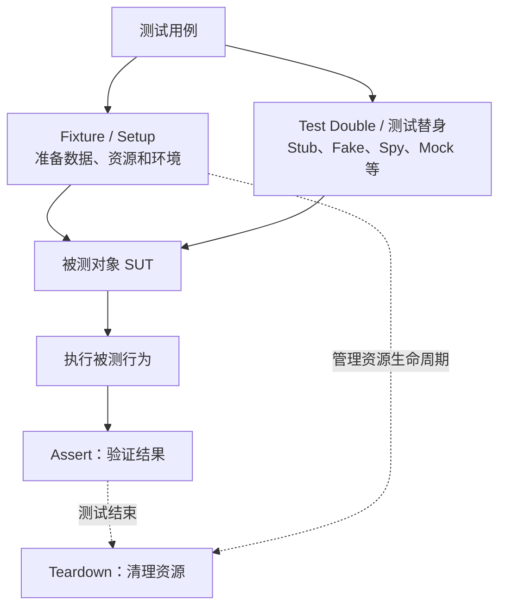
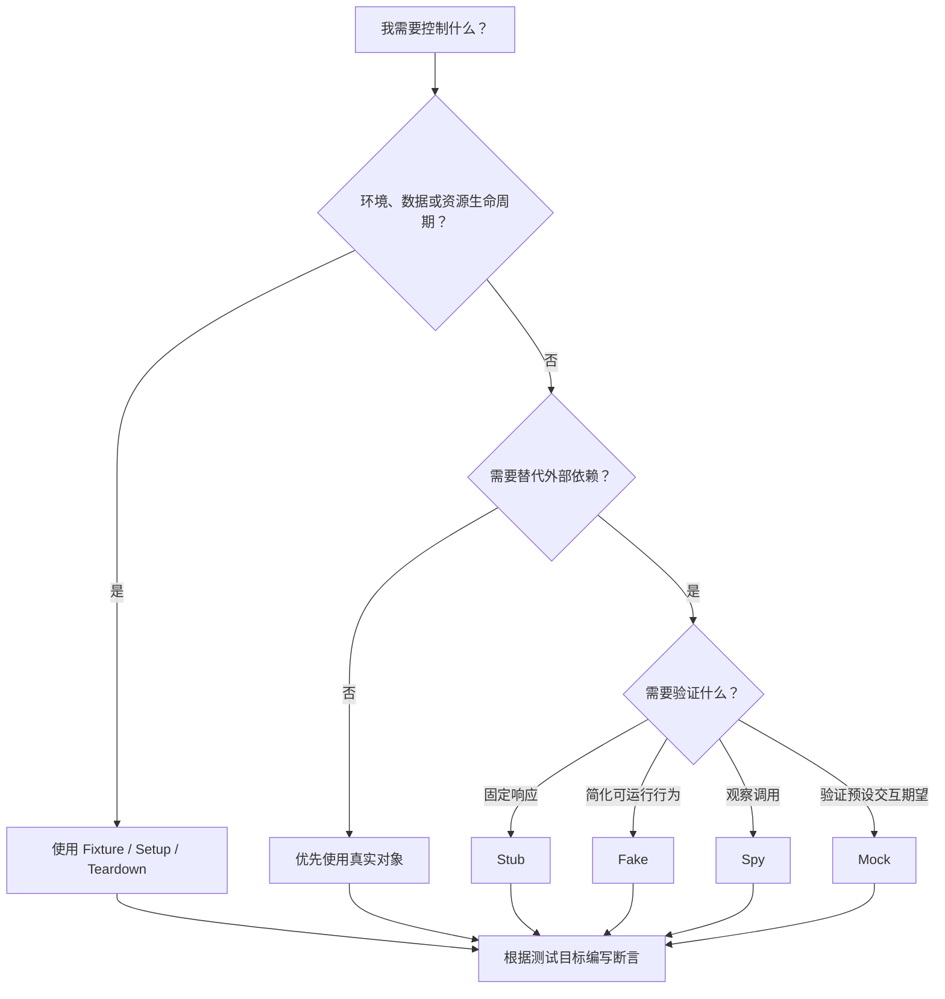

写测试时，你大概率遇到过这些词：Fixture（测试夹具）、Mock（模拟对象）、Stub（桩对象）、Fake（伪实现）、Spy（间谍对象）和 Dummy（哑对象）。

它们经常同时出现在测试代码中，甚至在一些文章里被混用。比如，测试一个用户资料页面时，我们可能需要准备用户数据、替换 HTTP 请求、观察函数调用，并在测试结束后恢复环境。

这些操作看起来都属于“为测试做准备”，但它们解决的是不同问题。把所有东西都称作 Mock，代码或许依然能够运行，但测试的设计会越来越模糊：哪些东西负责准备环境？哪些东西负责替代真实依赖？哪些东西只是记录调用？哪些断言才真正验证了业务行为？

本文从概念边界出发，结合 pytest、Vitest 和 Playwright 的例子，说明如何选择合适的测试工具。

## 一、先给出结论：它们不在同一个维度

最容易混淆的地方，是把 Fixture 和 Mock、Stub 当成同一类东西。

**Fixture 主要解决测试环境、数据和资源生命周期的问题；Test Double（测试替身）主要解决如何替代被测对象协作者的问题。** 二者可以一起使用，但不能直接画等号。

### 测试环境与测试替身的关系



*图示说明：测试用例通过 Fixture 准备环境和资源，并将测试替身注入被测对象；执行行为后验证结果，最后清理资源。*

假设正在测试用户资料页面：

1. 准备一个测试用户，属于测试数据准备。
2. 创建浏览器页面或测试上下文，属于环境准备。
3. 用预设响应替代真实 HTTP 接口，属于 Stub 式的依赖替代。
4. 记录某个函数是否被调用，属于 Spy 的典型用途。
5. 验证用户名称是否正确显示，属于断言。

这些步骤可以同时出现在一条测试流程里，但职责并不相同。

## 二、Fixture：为测试提供可靠的上下文

Fixture 的核心目标，是为测试提供一个已知、可靠的初始环境。它可能包含测试数据、数据库连接或事务、临时文件、浏览器页面、测试用户、测试替身，以及测试结束时需要执行的清理逻辑。

Fixture 不一定是某种特定对象类型。更准确地说，它是一种组织测试准备工作及资源生命周期的机制或模式。

### 2.1 pytest 中的 Fixture

在 Python 的 pytest 中，Fixture 是框架提供的一等功能。例如，我们希望每个测试都获得一份独立的订单数据：

```python
import pytest


@pytest.fixture
def order():
    return {
        "id": "order-001",
        "amount": 99.0,
        "status": "pending",
    }


def test_order_amount(order):
    assert order["amount"] == 99.0


def test_order_status(order):
    assert order["status"] == "pending"
```

测试函数通过参数声明自己需要的 Fixture。在默认的 `function` scope 下，pytest 会为不同测试函数分别创建 Fixture 实例，因此两个测试不会共享同一个字典。这样可以降低测试之间因修改共享数据而互相影响的风险。

### 2.2 Fixture 不只是准备数据，还要负责清理

如果 Fixture 创建了临时资源，就需要考虑如何释放。下面使用 pytest 的 `tmp_path` 创建临时文件，并在测试结束时删除：

```python
import pytest


@pytest.fixture
def temp_file(tmp_path):
    file_path = tmp_path / "sample.txt"
    file_path.write_text("hello", encoding="utf-8")

    yield file_path

    # 测试结束后执行清理逻辑
    file_path.unlink(missing_ok=True)


def test_temp_file_content(temp_file):
    assert temp_file.read_text(encoding="utf-8") == "hello"
```

这里的 `yield` 将 Fixture 分成两个阶段：

- `yield` 之前：准备资源。
- `yield` 之后：执行清理。

需要注意：如果 Fixture 在执行到 `yield` 之前就发生异常，`yield` 后面的代码不会因此自动执行。对于准备过程中可能部分成功、部分失败的复杂资源，应设计好对应的回收逻辑，或使用上下文管理器等资源管理方式。

参考：[pytest：About fixtures](https://docs.pytest.org/en/stable/explanation/fixtures.html)。

### 2.3 Playwright 中的 Fixture

前端开发者可能更熟悉 Playwright Test：

```typescript
import { test, expect } from '@playwright/test';

test('页面可以正常打开', async ({ page }) => {
  await page.goto('/');

  await expect(page).toHaveTitle(/.+/);
});
```

这里的 `page` 不是手动创建的普通变量，而是 Playwright Test 提供的内置 Fixture。框架会根据测试需要准备页面及其依赖的浏览器上下文，并在相应生命周期结束时进行清理。它也允许开发者通过 `test.extend()` 定义自定义 Fixture。

这与 pytest 的设计理念相似：测试声明依赖，框架负责准备和管理相应资源。但不要因此认为所有测试框架都内置了相同的 Fixture 系统。pytest 和 Playwright Test 提供了明确的 Fixture 机制；在 Vitest 或 Jest 中，开发者更常使用工厂函数、`beforeEach`、`afterEach` 等方式组织准备工作。这些方式可以实现相似目标，但 API 与生命周期机制并不相同。

参考：[Playwright：Fixtures](https://playwright.dev/docs/test-fixtures)。

## 三、Test Double：测试替身有哪些？

如果被测代码依赖真实 HTTP 接口、数据库或第三方服务，可以用一个可控对象替代真实依赖。这种对象统称为 **Test Double（测试替身）**。

Martin Fowler 在经典文章 [Mocks Aren't Stubs](https://martinfowler.com/articles/mocksArentStubs.html) 中介绍了几种常见测试替身，并重点讨论 Mock 与 Stub 的区别。需要注意，这套术语有相对明确的理论定义，但不同语言和测试框架的日常用法并不总是完全一致。

### 3.1 五种常见测试替身

| 类型 | 主要作用 | 典型场景 |
| --- | --- | --- |
| Dummy | 占据参数位置，测试中不会真正使用 | 构造函数要求 Logger，但当前测试不涉及日志 |
| Stub | 为依赖调用提供预先设定的响应 | HTTP 接口固定返回一份用户数据 |
| Fake | 提供可运行的简化实现，但不适合直接用于生产 | 使用内存字典实现简化版 Repository |
| Spy | 记录调用信息，以便测试后检查 | 验证通知函数是否被调用、调用了几次 |
| Mock | 预先配置交互期望，并验证这些期望是否满足 | 验证失败时是否调用指定的取消操作 |

可以进一步归纳为：Dummy 主要是占位；Stub 主要控制依赖的响应；Fake 提供真实可运行但经过简化的行为；Spy 主要观察调用；Mock 在经典定义中强调预设期望与交互验证。

**Stub 和 Mock 的关键区别，不在于它们是不是“假的”，而在于测试如何验证行为。** Stub 通常提供预设响应，测试重点是被测对象最终产生了什么结果。Mock 则把某些交互本身作为测试契约，例如是否调用某个方法、参数是否正确，以及调用是否符合预设期望。

### 3.2 Mock 不等于所有测试替身

日常开发中，很多人会把任何模拟对象统称为 Mock。这种说法并非完全不可理解，因为一些测试框架也会把相关 API 统称为 Mocking。

但讨论测试设计时，最好区分两个层次：

- **框架 API 的命名。**
- **测试替身在当前测试中的实际职责。**

例如，Vitest 的 `vi.fn()` 创建的 Mock Function 可以配置返回值，也会记录调用信息。它既可以承担 Stub 的职责，也可以承担 Spy 的职责。但仅仅创建一个 `vi.fn()`，并不意味着测试一定采用了经典定义中以预设交互期望为核心的 Mock 测试。

参考：[Vitest：Mock Functions](https://vitest.dev/guide/mocking/functions.html)。

## 四、用一个前端单元测试把概念串起来

假设有一个简单的用户问候函数：它从接口读取用户资料，再生成展示文案。

### 4.1 被测代码

```typescript
// greeting.ts

export type Profile = {
  nickname?: string;
};

export type ProfileApi = {
  getProfile(id: string): Promise<Profile>;
};

export async function greeting(
  id: string,
  api: ProfileApi,
): Promise<string> {
  const profile = await api.getProfile(id);

  return profile.nickname
    ? `你好，${profile.nickname}`
    : '你好，访客';
}
```

这里有一个值得关注的设计：函数通过参数接收 `api`，而不是在函数内部直接创建 HTTP 客户端并发起请求。这让被测逻辑与外部依赖分离。测试时，我们既可以传入真实实现，也可以传入 Stub 或其他测试替身。

这并不意味着所有代码都必须引入依赖注入框架，而是说：让外部依赖具有可替换性，通常能降低测试成本。

### 4.2 使用 Stub 控制返回结果

```typescript
import { expect, it } from 'vitest';
import { greeting, type ProfileApi } from './greeting';

it('根据用户昵称生成问候语', async () => {
  const api: ProfileApi = {
    async getProfile() {
      return { nickname: '小林' };
    },
  };

  await expect(
    greeting('user-001', api),
  ).resolves.toBe('你好，小林');
});
```

这里的 `api` 是一个简单的 Stub：它不访问真实服务，只返回预先定义的数据。测试验证的是业务结果。我们不关心请求到底通过 Axios、Fetch 还是其他 HTTP 客户端发送，因为当前测试目标是问候语生成逻辑。

### 4.3 使用 Spy 观察调用

如果还需要验证用户 ID 是否正确传递，可以使用 Vitest 的 Mock Function：

```typescript
import { expect, it, vi } from 'vitest';
import { greeting, type ProfileApi } from './greeting';

it('使用正确的用户 ID 获取资料', async () => {
  const getProfile = vi.fn(
    async (_id: string) => ({ nickname: '小林' }),
  );

  const api: ProfileApi = { getProfile };

  await expect(
    greeting('user-001', api),
  ).resolves.toBe('你好，小林');

  expect(getProfile).toHaveBeenCalledWith('user-001');
});
```

这个函数有两个作用：通过固定返回值充当 Stub；记录调用信息，让我们能够检查传入的参数。在 Vitest 的 API 术语中，我们使用的是 Mock Function；从测试替身的职责来看，它同时具备 Stub 和 Spy 的特征。

但这里也有一个问题值得思考：**我们真的需要验证这个函数的调用参数吗？**

如果测试目标只是确认问候语正确，那么验证最终结果可能已经足够。如果用户 ID 的传递本身就是关键业务行为，或者错误 ID 会导致错误的数据访问，那么额外检查调用参数就有意义。

不要因为框架支持某种断言，就把它机械地加到每个测试中。

### 4.4 什么时候应该验证交互？

考虑另一个场景：订单支付失败后，业务要求调用支付服务的取消操作。这里，“是否调用取消操作”本身就是需求的一部分。如果测试只检查页面显示了“支付失败”，却没有检查取消操作是否执行，那么某些关键行为可能被遗漏。

反过来，如果测试只是想验证一个纯函数的计算结果，强行 Mock 它调用的每个内部方法，反而可能让测试与实现细节绑定得过紧。

## 五、在 Playwright 中，Fixture 和 Stub 可以一起使用

单元测试主要关注局部逻辑。到了端到端测试，我们还需要考虑浏览器、页面、路由、网络请求以及测试环境。

Playwright 的 Fixture 可以为测试准备浏览器页面，而网络路由拦截则可以控制页面收到的响应：

```typescript
import { test, expect } from '@playwright/test';

test('用户资料页面显示接口返回的昵称', async ({ page }) => {
  await page.route('**/api/profile', async (route) => {
    await route.fulfill({
      status: 200,
      contentType: 'application/json',
      body: JSON.stringify({
        nickname: '小林',
      }),
    });
  });

  await page.goto('/profile');

  await expect(
    page.getByRole('heading', { name: '你好，小林' }),
  ).toBeVisible();
});
```

这是一个示意案例，实际项目需要根据真实 API 路径和页面元素调整匹配规则。这里有两个不同概念：

- `page` 是 Playwright 提供的 Fixture。
- `page.route()` 返回的固定 HTTP 响应，是 Stub 式的依赖替代。

**路由拦截必须在目标请求发出之前设置。** 因此示例先注册 `page.route()`，再执行 `page.goto()`。

### 5.1 应该 Mock API，还是连接真实后端？

这取决于测试目标。

如果要验证前端在不同响应下的表现，拦截 API 可以让测试更加可控，例如成功返回、空列表、401 或 500、请求超时、数据字段缺失。

如果要验证前后端是否真的能够正确协作，就不能只依靠被 Mock 的 API。Stub 返回了预设结果，并不能证明真实后端也会返回同样结构，更不能证明认证、数据库查询和网络通信都正常。

因此，单元测试、组件测试、端到端测试和集成测试应当互相补充，而不是相互替代。

## 六、如何为不同场景选择合适的工具？

可以用下面的决策图快速判断。



*图示说明：环境与资源生命周期交给 Fixture；固定依赖响应使用 Stub；需要简化可运行实现时使用 Fake；观察调用使用 Spy；交互期望本身属于需求时使用 Mock。*

| 测试场景 | 推荐方式 | 原因 |
| --- | --- | --- |
| 纯函数计算结果 | 直接调用真实函数 | 无须额外模拟依赖 |
| 前端请求成功或失败 | Stub 或网络拦截 | 可以稳定构造不同响应 |
| 验证函数调用参数 | Spy 或带调用记录的 Mock Function | 能观察调用过程 |
| 测试业务逻辑但不希望依赖真实数据库 | Fake Repository | 保留必要行为，降低基础设施成本 |
| 浏览器页面测试 | Playwright Fixture | 管理页面、浏览器上下文等资源 |
| 验证真实数据库 SQL、事务或约束 | 集成测试连接真实数据库 | Fake 无法证明真实数据库行为 |
| 验证多个服务之间的真实契约 | 集成测试或契约测试 | 单纯替换依赖无法验证真实协作 |

Fake 可以提供可运行的简化实现，但不一定与真实依赖完全一致。例如，内存 Repository 可以实现基本查询和写入，却未必具有真实数据库的事务隔离、索引行为或约束检查。因此 Fake 可以帮助测试业务逻辑，但不应成为真实集成测试的唯一替代品。

## 七、常见误区：测试通过了，质量却未必提高

### 误区一：所有测试替身都叫 Mock

这样会模糊测试设计。建议在讨论时区分“使用某个框架的 Mock API”和“使用什么类型的测试替身”。

例如，说“使用 `vi.fn()` 提供固定返回值并记录调用”，比简单说“这里 Mock 了一下”更准确。

### 误区二：所有依赖都应该 Mock

如果依赖本身足够轻量、稳定，而且运行成本很低，那么使用真实对象往往更简单。测试一个字符串格式化函数，没有必要把它内部调用的每个纯函数都替换掉。

过度 Mock 会让测试验证的内容逐渐偏离真实业务行为，甚至出现“所有 Mock 都符合预期，但真实系统依然出错”的情况。

### 误区三：只验证内部调用，不验证最终结果

调用次数、参数和调用顺序都可以成为有价值的断言，但前提是它们对应明确的行为契约。如果业务只关心结果，过度检查内部实现可能让重构变得困难。

更稳妥的原则是：

- 优先验证对外可观察的业务结果。
- 当交互本身属于需求时，再验证交互。
- 不要将实现细节默认当作业务契约。

### 误区四：共享 Fixture 一定更高效

Fixture 可以复用，但共享状态也可能导致测试互相影响。例如，多个测试共享一个可变用户对象，其中一个测试修改了用户昵称，另一个测试就可能依赖执行顺序才能通过。

pytest 提供 `function`、`class`、`module`、`package` 和 `session` 等 Fixture scope。扩大 scope 可以减少重复准备，但也可能扩大状态共享的范围。因此，选择 scope 时不应只考虑执行速度，还应考虑隔离性。

参考：[pytest：Fixture scopes](https://docs.pytest.org/en/stable/how-to/fixtures.html)。

### 误区五：Mock 清理只需要关注调用记录

测试替身可能保存调用历史、返回值配置、模拟实现或全局替换状态。如果这些状态泄漏到后续测试，就可能出现难以复现的失败。

Vitest 提供不同的清理方式：

- `mockClear()`：清除调用记录，但保留当前模拟实现。
- `mockReset()`：清除调用记录并重置模拟实现。
- `mockRestore()`：对通过 `vi.spyOn()` 创建的 Spy 恢复原始实现。

具体行为与 API 类型有关，应根据需求选择，而不是一律执行某种清理操作。参考：[Vitest：Mocking](https://vitest.dev/guide/mocking.html)。

### 误区六：端到端测试里 Mock 了接口，就等于验证了整个系统

如果接口被替换，测试可以验证前端如何处理给定响应，却不能验证真实后端是否能够正确产生该响应。同理，如果使用 Fake 数据库，测试也不能自动证明真实数据库的事务、索引和约束都符合预期。

**测试通过只能证明被测试的那部分行为符合断言，不能证明没有被覆盖的系统边界也正确。**

## 八、实践建议：从简单、显式、可隔离开始

### 1. 先明确测试目标

编写测试之前，先回答：

- 我想验证什么行为？
- 哪些依赖必须真实运行？
- 哪些依赖可以替代？
- 最终应该通过什么断言判断成功？

如果这些问题都没有明确，就很容易陷入“为了写测试而写测试”。

### 2. 将 Fixture 与测试替身分开设计

Fixture 负责准备测试所需的环境和资源；Stub、Fake、Spy、Mock 则根据测试目标承担不同职责。它们可以组合，但不必全部塞进一个巨大的 Setup 函数里。

### 3. 优先使用显式依赖

对于业务代码，尽可能让外部依赖可以通过参数、构造函数或其他明确边界注入。这样不仅有助于测试，也有利于理解代码依赖关系。

不过，不必为了测试引入过度复杂的抽象。设计应当与系统实际复杂度相匹配。

### 4. 先保证隔离，再优化速度

如果测试偶尔失败，先检查：

- 是否存在共享可变数据？
- 是否依赖测试执行顺序？
- 是否没有恢复全局状态？
- 是否遗漏临时资源清理？
- 是否依赖真实网络或外部服务的不稳定状态？

确认隔离性之后，再考虑是否通过扩大 Fixture scope、复用昂贵资源或并行执行来优化性能。

### 5. 保留真实集成测试

测试替身可以降低单元测试成本，但无法完全替代真实环境验证。合理的测试体系应当在快速反馈和真实集成之间取得平衡：

- 单元测试验证局部业务逻辑。
- 组件或页面测试验证用户可观察的行为。
- 集成测试验证真实依赖之间的协作。
- 端到端测试验证关键用户流程。

不同层次各自承担明确职责，才能避免所有测试都在模拟环境中通过，却在真实环境中失败。

## 九、总结

Fixture、Stub、Fake、Spy 和 Mock 都与测试有关，但它们并不是同一层次的概念。

Fixture 关注测试环境、数据和资源的准备与清理；测试替身则帮助我们控制或观察被测对象的协作者。Stub 主要提供预设响应，Fake 提供简化的可运行实现，Spy 记录调用，Mock 在经典定义中强调交互期望的验证。

理解这些区别后，我们就不必为了使用测试框架而机械地 Mock 一切，也不必为了复用代码而把所有准备逻辑塞进一个巨大的 Fixture。

**测试不是为了证明代码能够通过某些断言，而是为了用尽可能清晰、可靠的方式验证我们真正关心的行为。** 选择正确的测试工具，是实现这一目标的一部分；明确测试边界、控制共享状态、验证真实集成，同样不可缺少。

## 参考资料

1. Martin Fowler, [Mocks Aren't Stubs](https://martinfowler.com/articles/mocksArentStubs.html)
2. pytest, [About fixtures](https://docs.pytest.org/en/stable/explanation/fixtures.html)
3. pytest, [How to use fixtures](https://docs.pytest.org/en/stable/how-to/fixtures.html)
4. Vitest, [Mock Functions](https://vitest.dev/guide/mocking/functions.html)
5. Vitest, [Mocking](https://vitest.dev/guide/mocking.html)
6. Playwright, [Fixtures](https://playwright.dev/docs/test-fixtures)
