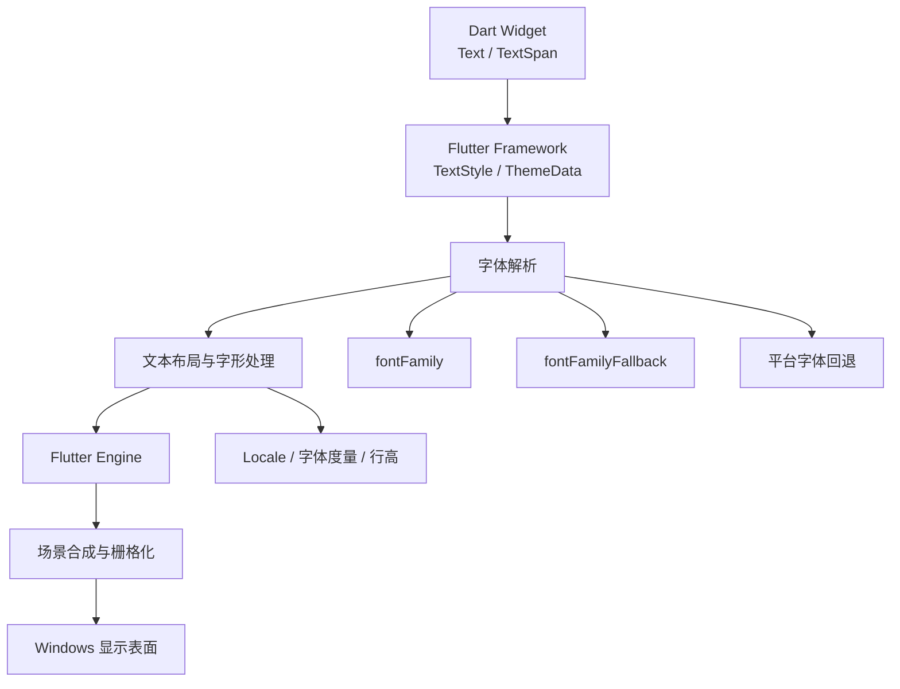
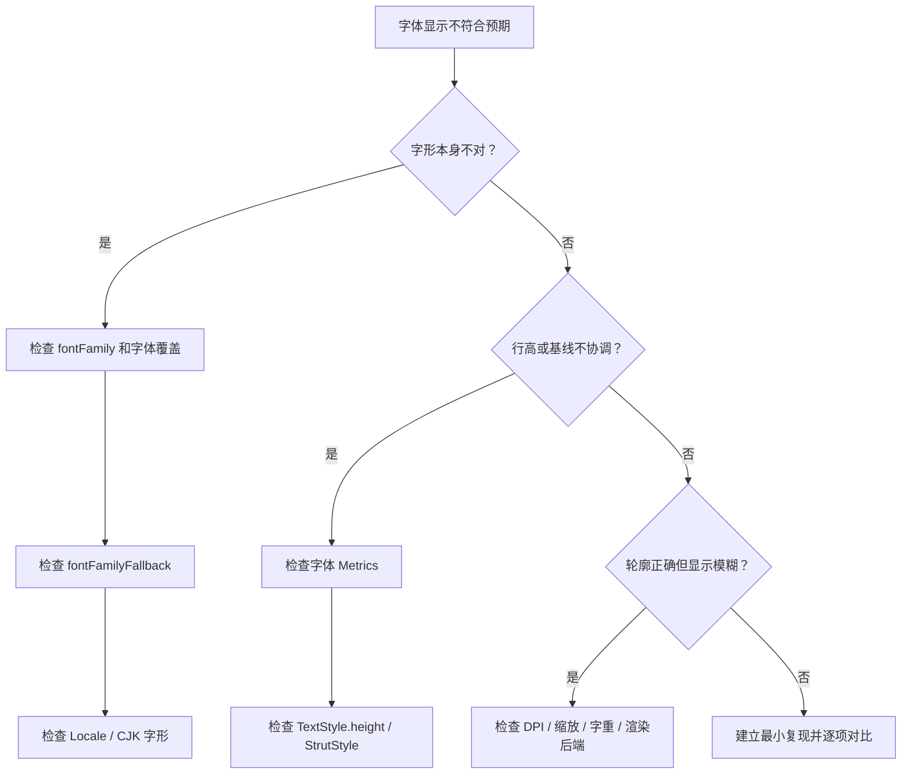

使用 Flutter 开发 Windows 桌面应用时，有时会遇到一个微妙的问题：同样是中文文字，Windows 原生应用看起来熟悉、清晰；换成 Flutter 桌面应用后，字体却显得不太一样，尤其是中文的观感，很难直接达到系统原生应用的效果。

很多人的第一反应是：是不是 Flutter 使用了自绘引擎，所以字体渲染不如 Windows 原生应用？这个判断有一点道理，但并不完整。字体看起来不一致，不一定是 GPU 或绘制引擎的问题；字体家族选择、字符覆盖与回退、区域语言、字体度量和最终栅格化都可能参与其中。

本文从这些问题出发，梳理 Flutter Windows 桌面端的文本显示机制，并给出几种实际可用的改善方案。

## 一、Flutter 为什么不像原生 Windows 应用？

先明确一个事实：Flutter 并不是把 Dart Widget 转换成 Windows 原生控件，再交给 Windows 自己绘制。Flutter Framework 通过 Widget、Element、RenderObject 构建界面；Engine 负责文字布局、场景合成和栅格化。也就是说，它可以使用操作系统已安装的字体，但默认不会把整套界面交给 Windows 原生文本控件绘制。



这里需要区分两个概念：

- **使用系统字体**：Flutter 可以使用操作系统已安装的字体。
- **使用系统原生文本控件绘制**：Flutter 默认并不是这样工作的。

统一的渲染模型有利于跨平台 UI 一致性，但也意味着开发者需要主动处理平台差异。

## 二、先看字体选择与字体回退

Windows UI 的拉丁文字通常与 Segoe UI 关联，而中文的视觉效果还取决于系统提供的 CJK 字体以及回退规则。不要把“Windows 默认字体”理解成一份能覆盖所有 Unicode 字符的单一字体文件。

字体文件不一定包含所有字符。一套字体可能完整支持拉丁字母，却没有覆盖全部中文汉字；当文本出现当前字体没有的字形时，文本系统需要寻找另一套字体补齐，这就是字体回退（font fallback）。

Flutter 的 `TextStyle` 会先查找 `fontFamily`，再按顺序查找 `fontFamilyFallback`，最后才交给平台默认回退。只有前面的候选缺少对应字形时，才会继续向后尝试。

```dart
const TextStyle(
  fontFamily: 'Segoe UI',
  fontFamilyFallback: [
    'Microsoft YaHei UI',
    'Microsoft YaHei',
    'Noto Sans CJK SC',
  ],
)
```

可以把它理解为：英文优先使用 Segoe UI；某个中文字符无法由它提供时，再尝试微软雅黑 UI、微软雅黑及后续候选。候选字体必须真实存在于目标设备上，否则不会产生预期效果。

### 为什么中英文混排看起来不协调？

例如下面这一行：

```text
Flutter 桌面应用开发：中文字体与 English Typography
```

`Flutter` 可能来自 Segoe UI，中文来自一套 CJK 字体，Emoji 又可能来自另一套系统字体。这些字体的设计风格、字重、基线和度量并不相同。因此英文偏细、中文偏粗，或视觉高度不协调，并不一定是 Flutter 的 Bug，而是回退链的自然结果。

## 三、别忽略 Locale：中文、日文和韩文并不相同

中文、日文和韩文共享大量汉字编码，但同一个 Unicode 字符在不同语言环境中可能有不同的推荐字形。Unicode 的统一编码解决了字符编码问题，却不意味着所有地区都应该使用完全相同的字形。

Flutter 的 `Text` 和 `TextStyle` 都支持 `locale`。支持 OpenType `locl` 特性的字体可以据此选择地区字形；`FontFeature.localeAware` 默认启用。通常无需逐个 Text 手动设置，因为 `Text` 会从应用的 `Localizations` 环境继承 Locale。

```dart
const Text(
  '草、直、令、骨',
  locale: Locale('zh', 'CN'),
  style: TextStyle(fontFamily: 'Noto Sans CJK SC'),
)
```

繁体中文可使用 `Locale('zh', 'TW')`。需要注意：`fontFamily` 决定优先使用什么字体；`locale` 只在字体支持地区字形差异时帮助选择字形。它不能替代字体安装，更不能让一个不支持中文的字体突然拥有中文字符。

## 四、字体看起来不一样，不只是字形问题

即使使用相同的字体文件，文本仍可能不同。字体还包含 Ascent、Descent、Leading 和 glyph advance 等度量信息，它们会影响行高、基线和相邻字符的布局。

### `fontSize` 不等于实际行高

```dart
const Text(
  '中文字体测试',
  style: TextStyle(
    fontSize: 16,
    height: 1.5,
  ),
)
```

`fontSize` 是字形大小，不表示每行一定恰好占 16 个逻辑像素；不设置 `height` 时，布局使用字体自身度量。显式指定 `height` 后，行高按字形 EM-square 及字体的 ascent/descent 比例参与计算。因而 `height: 1.0` 也不等同于“不设置 height”。

### 使用 StrutStyle 统一段落行高

一个段落包含不同字体或字号时，行高可能跳动。`StrutStyle` 可以为段落设定最小的垂直度量：

```dart
const Text(
  '第一行中文文本\nSecond line English\n第三行混合文本',
  strutStyle: StrutStyle(
    fontFamily: 'Microsoft YaHei',
    fontSize: 16,
    height: 1.5,
  ),
)
```

它控制的是行盒的最小高度，不会改变字体字形。`forceStrutHeight` 会强制各行采用 strut 高度；它能保证行距一致，但较高字形可能与相邻行重叠，因此不应未经验证地全局开启。

## 五、真正的渲染差异：Flutter Engine 与 Windows

完成字体家族、回退和行高检查后，如果字体轮廓正确却仍觉得不够清晰，才应进一步看渲染层。最终效果可能同时受到字体文件、字重、抗锯齿与栅格化、显示器 DPI、系统缩放比例以及当前 Engine/渲染后端实现的影响。

不要把所有问题都归咎于 Impeller 或某个渲染后端：

1. 字体家族不正确，切换后端无法解决。
2. 字符缺失，需要处理覆盖范围与回退。
3. 行高不合理，需要检查度量、`TextStyle.height` 和 `StrutStyle`。
4. 只有字形与布局都正确、边缘仍异常时，才值得排查 DPI、缩放、抗锯齿和渲染后端。

## 六、如何改善 Flutter Windows 的中文字体？

### 方案一：使用系统字体与明确的回退链

如果目标是尽量接近 Windows 的字体风格，可以在主题中明确指定：

```dart
MaterialApp(
  theme: ThemeData(
    fontFamily: 'Segoe UI',
    fontFamilyFallback: const [
      'Microsoft YaHei UI',
      'Microsoft YaHei',
    ],
  ),
  home: const HomePage(),
)
```

它不需要打包字体，能让英文和中文分别使用合适的系统字体，也避免完整中文字体带来的体积增长。不过，Windows 版本、系统语言和字体安装情况并不完全相同，不能假设每台设备都拥有同样的字体环境。

### 方案二：在应用中内置字体

若更重视跨设备一致性，可以把有合适授权的字体作为应用资源打包，并准备真实的不同字重：

```yaml
flutter:
  fonts:
    - family: AppSansSC
      fonts:
        - asset: assets/fonts/AppSansSC-Regular.otf
          weight: 400
        - asset: assets/fonts/AppSansSC-Medium.otf
          weight: 500
        - asset: assets/fonts/AppSansSC-Bold.otf
          weight: 700
```

```dart
MaterialApp(
  theme: ThemeData(fontFamily: 'AppSansSC'),
  home: const HomePage(),
)
```

Flutter 支持 `.ttc`、`.ttf`、`.otf`；桌面端不能直接将 `.woff`、`.woff2` 作为字体资源。中文字体往往很大，可以评估合法的子集化方案，但必须覆盖真实业务字符。不要随意从 Windows 系统目录复制商业字体并重新分发，应先确认许可证。

### 方案三：正确配置字重

Flutter 不会根据文件名自动推断字重；若没有为 `w700` 等声明相应字体文件，可能会用模拟效果。正文、强调和标题最好分别使用实际存在的 Regular、Medium、Bold，而不是让一份 Regular 字体承担所有字重。

### 方案四：建立统一的文本主题

不要在每个 `Text` 中零散配置字体。将字体、字号、行高和字重收敛到 `TextTheme`，能让大段中文桌面 UI 更容易维护：

```dart
final appTheme = ThemeData(
  fontFamily: 'AppSansSC',
  textTheme: const TextTheme(
    bodyMedium: TextStyle(fontSize: 14, height: 1.5, fontWeight: FontWeight.w400),
    bodyLarge: TextStyle(fontSize: 16, height: 1.5, fontWeight: FontWeight.w400),
    titleMedium: TextStyle(fontSize: 18, height: 1.4, fontWeight: FontWeight.w500),
    headlineSmall: TextStyle(fontSize: 24, height: 1.3, fontWeight: FontWeight.w700),
  ),
);
```

## 七、如何定位到底是哪一层出了问题？

不要一开始就修改大量样式。先建立一个字体对比页：

```dart
const samples = [
  '简体中文：草、直、令、骨',
  'English Typography 0123456789',
  'Flutter 桌面应用开发',
  '中文与 English 混排测试',
  '标点符号：，。！？（）【】',
  '字体字重：Regular / Medium / Bold',
];
```

分别比较默认平台配置、系统字体回退链、内置完整中文字体、以及不同 Locale。比较截图时应保持 Flutter SDK、Windows 版本、显示器分辨率、缩放比例、字号、字重、窗口尺寸和文本内容一致；否则像素缩放差异很容易被误判为字体渲染问题。



## 八、几个常见误区

1. **Flutter 使用自绘引擎，所以不能使用系统字体。** 错误。Flutter 有自己的 UI 渲染模型，但仍可使用系统字体或应用内置字体。
2. **设置了 `fontFamily`，所有字符一定来自同一套字体。** 错误。当前字体缺字时仍会发生回退，尤其是中英文、Emoji 混排。
3. **只调字号和字间距即可解决字体问题。** 错误。这些参数不能修复错误字体或缺失字形。
4. **只要使用微软雅黑，所有 Windows 电脑就会一致。** 不完全正确。字体版本、系统配置和可用字形范围都可能不同。
5. **换成某个渲染后端就能解决字体显示问题。** 不可靠。应先确认字体选择、Locale 与度量正确。

## 九、总结

Flutter Windows 桌面端的字体问题并不是简单的“自绘引擎不如原生”。它至少涉及五个层次：

1. **字体选择**：默认和显式字体是否符合设计预期。
2. **字体回退**：目标字符缺失时后续候选是什么。
3. **区域语言**：相同 Unicode 字符是否应按 Locale 选字形。
4. **字体度量**：字号、行高、基线与字重是否协调。
5. **图形渲染**：轮廓最终如何变成屏幕像素。

若只是希望中文观感更贴近 Windows 原生程序，先尝试显式配置英文主字体和中文回退链；若产品要求跨设备高度一致，则选用授权合适的内置字体，并统一字重、行高与文本主题。可靠的字体优化不是不断调整 `fontSize`，而是先明确字体策略，再控制度量，最后才处理渲染层细节。

## 参考资料

1. [Flutter architectural overview](https://docs.flutter.dev/resources/architectural-overview) — Framework、Engine 与渲染架构。
2. [TextStyle.fontFamily](https://api.flutter.dev/flutter/painting/TextStyle/fontFamily.html) — 字体与回退顺序。
3. [Text.locale](https://api.flutter.dev/flutter/widgets/Text/locale.html) 与 [FontFeature.localeAware](https://api.flutter.dev/flutter/dart-ui/FontFeature/FontFeature.localeAware.html) — 区域字形选择。
4. [StrutStyle](https://api.flutter.dev/flutter/painting/StrutStyle-class.html) — 段落行高与强制 strut 的边界。
5. [Use a custom font](https://docs.flutter.dev/cookbook/design/fonts) — 自定义字体格式、资源声明和字重配置。
