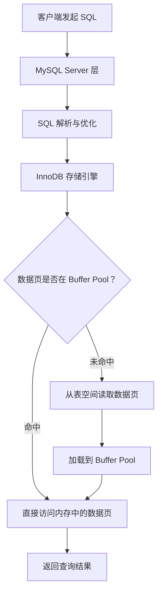
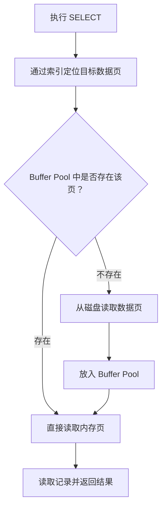
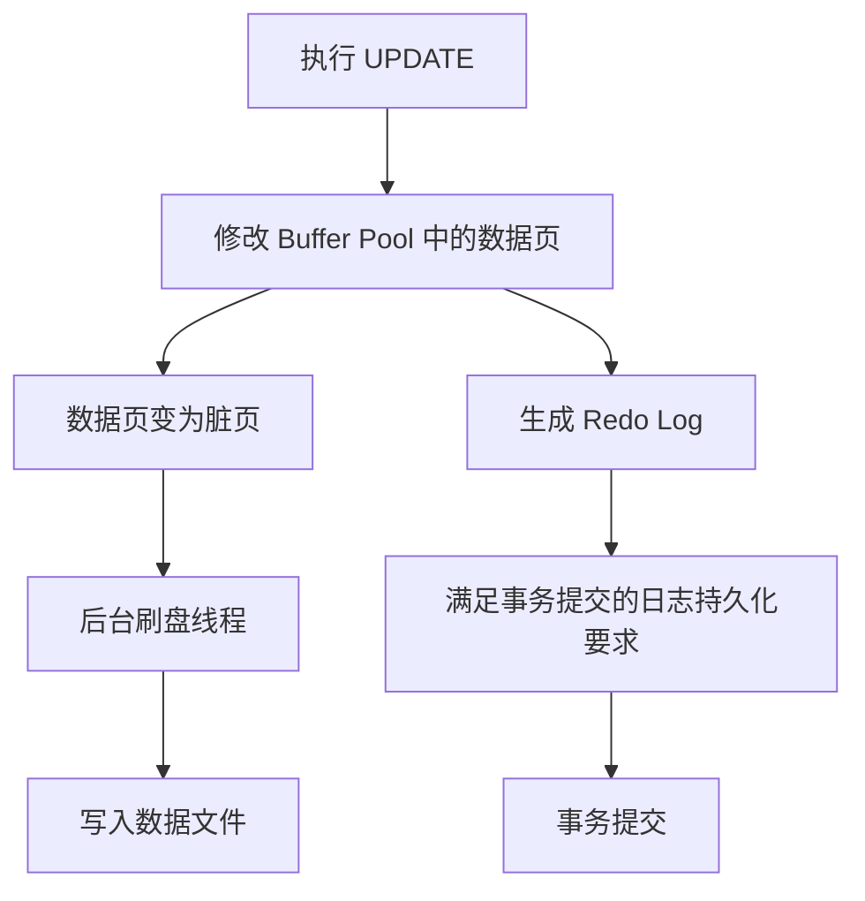

在日常开发中，我们经常会听到这样的说法：

- MySQL 有缓存机制，查询过的数据会被缓存起来。
- 给 MySQL 分配更多内存，可以减少磁盘 IO。
- MySQL 8.0 已经移除了 Query Cache。

这些说法都没错，但它们容易让人产生一个疑问：**既然 MySQL 8.0 移除了查询缓存，为什么它仍然能够利用内存缓存数据？**

原因在于，MySQL 的缓存并不是一个单一的组件。不同层次、不同用途的缓存共同参与了 SQL 的执行过程。理解它们之间的区别，才能真正理解 MySQL 的缓存机制。

本文以 MySQL 8.0 和 InnoDB 为主线，适当对比 MySQL 5.7。

## 一、为什么数据库需要缓存？

先思考一个简单的问题：执行一条 SQL，数据究竟从哪里来？

数据库中的数据最终存储在磁盘上。即使使用 SSD，磁盘 IO 的延迟通常也远高于内存访问。

如果每次查询都必须从磁盘读取数据，数据库的性能很容易受到存储设备的限制。

缓存的核心目的就是：**把更可能被再次访问的数据保留在更快的存储介质中，减少重复的慢速 IO。**

可以用一个简化的层次结构理解：



这里需要注意：缓存并不意味着数据库不再访问磁盘，而是尽可能减少访问磁盘的次数。

## 二、MySQL 的缓存主要有哪些？

从架构上看，可以把 MySQL 中常见的缓存分为两类：

1. **Server 层缓存**：由 MySQL Server 管理，涉及连接线程、表定义、表打开状态、预处理语句等。
2. **存储引擎层缓存**：由具体存储引擎管理。对于 InnoDB 来说，最重要的就是 Buffer Pool。

此外，操作系统也会利用文件系统缓存，应用程序还可能在 MySQL 外部使用 Redis 等缓存系统。这些都不应该与 InnoDB Buffer Pool 混为一谈。

### 2.1 Query Cache：曾经的查询结果缓存

Query Cache 是 MySQL 早期提供的一种查询缓存机制。

它的思路非常直接：

- 缓存 SQL 语句及其对应的查询结果。
- 当收到符合缓存条件的相同查询时，直接返回之前保存的结果。
- 当相关表发生数据变更时，失效对应的缓存结果。

例如：

```sql
SELECT name, age FROM user WHERE id = 100;
```

假设第一次执行时没有缓存，MySQL 正常查询并返回结果，同时将结果放入 Query Cache。

如果之后再次执行符合缓存条件的相同 SQL，就可能直接从 Query Cache 返回结果，而不必重新执行查询。

看起来很理想，但它存在一个比较严重的问题：**缓存失效与并发竞争的成本可能抵消缓存带来的收益。**

假设某张表有大量读请求，同时也存在频繁写入：

1. 读请求将查询结果放入缓存。
2. 写请求修改表中的数据。
3. 与该表相关的查询缓存需要失效。
4. 后续读请求重新执行查询并再次尝试缓存。

在高并发环境下，查询缓存的维护和同步可能带来额外开销。尤其是旧版本中，共享查询缓存还可能成为并发访问的瓶颈。

因此，Query Cache 从 MySQL 5.7.20 开始被标记为弃用，并在 MySQL 8.0 中正式移除。

> 注意：MySQL 8.0 移除的是 Query Cache，而不是所有缓存。InnoDB Buffer Pool 仍然是 MySQL 性能优化中非常重要的组成部分。

### 2.2 InnoDB Buffer Pool：真正重要的数据缓存

如果说 Query Cache 缓存的是 SQL 查询结果，那么 Buffer Pool 缓存的就是 **InnoDB 从磁盘读取的数据页（Page）**。

这是两种完全不同的缓存思路。

InnoDB 在读取数据时，并不是简单地把查询结果保存起来，而是以数据页为单位，将磁盘中的数据页加载到内存。

例如，一张表的数据分布在多个数据页中：

- 第一次查询某条记录时，相关数据页可能需要从磁盘读取。
- InnoDB 将数据页加载到 Buffer Pool。
- 后续查询如果访问同一个数据页，就可以直接从内存读取。

Buffer Pool 缓存的内容不仅包括表数据页，也包括索引页，以及其他 InnoDB 管理的页类型。

可以把它理解为 InnoDB 自己维护的一块内存空间，用来缓存经常访问的数据库页面。

#### Buffer Pool 的工作流程



这里有一个很重要的细节：

**Buffer Pool 缓存的是数据页，而不是某一条 SQL 的执行结果。**

因此，即使两条 SQL 的写法不同，只要它们最终访问了相同的数据页，也有机会复用 Buffer Pool 中已经加载的数据。

这也是为什么 InnoDB Buffer Pool 比传统 Query Cache 更适合作为存储引擎层的基础缓存。

## 三、Buffer Pool 内部是如何管理缓存的？

Buffer Pool 并不是一个简单的 Map。它需要解决几个问题：

- 如何判断一个数据页是否已经被缓存？
- 内存空间有限，应该保留哪些数据页？
- 缓存空间不足时，应该淘汰哪些数据页？
- 数据被修改后，如何保证最终持久化到磁盘？

### 3.1 Buffer Pool 的基本结构

Buffer Pool 内部维护着多个数据页及其管理信息。

可以简化理解为：

| 组成 | 作用 |
|---|---|
| 数据页 | 缓存从磁盘读取的 InnoDB 页面 |
| Page Hash | 根据页标识快速定位已经缓存的页面 |
| LRU List | 管理页面的访问热度与淘汰顺序 |
| Free List | 管理当前可供使用的空闲页面 |
| Flush List | 管理已经被修改、需要刷盘的脏页 |

其中，LRU List 是理解 Buffer Pool 缓存淘汰策略的关键。

### 3.2 LRU：最近最少使用淘汰策略

LRU（Least Recently Used）是一种经典的缓存淘汰算法。

它的核心思想是：

> 最近访问过的数据更有可能在近期再次被访问；长时间没有访问的数据，更适合被淘汰。

假设 Buffer Pool 只能容纳 5 个数据页：

```text
最近使用                                      最久未使用
  Page A  ->  Page B  ->  Page C  ->  Page D  ->  Page E
```

此时如果需要加载 Page F，而内存空间已经不足，就需要淘汰一个页面。

按照普通 LRU 的思路，Page E 会被淘汰。

但是，InnoDB 并没有直接采用最简单的 LRU 实现，而是使用了 **改进的 LRU 算法，也称为 Midpoint Insertion Strategy（中点插入策略）**。

#### 为什么不直接使用普通 LRU？

考虑一个场景：

执行一次全表扫描，需要依次读取大量数据页。这些数据页可能只会被访问一次。

如果每次读取都把新页面放在 LRU 链表的头部，那么大量只使用一次的数据就可能挤掉原本经常访问的热点页面。

这就是所谓的缓存污染（Cache Pollution）。

InnoDB 为了解决这个问题，将 LRU 链表分为两个区域：

- **New Sublist（新生代）**：存放较热的数据页。
- **Old Sublist（老年代）**：存放新加载或相对不活跃的数据页。

新读取的数据页默认插入到 Old Sublist 的头部，而不是整个 LRU 链表的头部。

```text
LRU List

┌──────────────────────────────┬──────────────────────────────┐
│         New Sublist          │          Old Sublist         │
│                              │                              │
│  热点页面                    │  新加载页面                  │
│  Page A -> Page B -> Page C  │  Page D -> Page E -> Page F  │
│                              │                              │
└──────────────────────────────┴──────────────────────────────┘
  最近使用                                             最久未使用
```

当 Old Sublist 中的页面再次被访问，并且满足一定条件后，才会被提升到 New Sublist。

这种机制能够有效降低全表扫描等操作对热点数据的影响。

相关参数：

```sql
SHOW VARIABLES LIKE 'innodb_old_blocks_pct';
SHOW VARIABLES LIKE 'innodb_old_blocks_time';
```

其中：

- `innodb_old_blocks_pct`：Old Sublist 占整个 LRU 链表的比例，默认通常为 37%。
- `innodb_old_blocks_time`：页面进入 Old Sublist 后，需要经过多长时间再次访问，才允许其提升到 New Sublist。

### 3.3 脏页与刷盘机制

缓存数据并不意味着所有操作都只发生在内存中。

假设我们执行：

```sql
UPDATE user SET age = 30 WHERE id = 100;
```

InnoDB 找到对应的数据页，将修改应用到内存中的页面。

此时，内存中的页面已经发生变化，但磁盘上的数据页不一定立即更新。

**内存中已经被修改、但尚未写入磁盘的数据页，就是脏页（Dirty Page）。**

InnoDB 会通过后台刷盘机制，将脏页逐步写入磁盘。

这里还涉及一个重要机制：Redo Log。

事务修改数据时，InnoDB 会按照 WAL（Write-Ahead Logging，预写日志）原则，先保证相关 Redo Log 持久化条件得到满足，再允许事务提交；数据页本身可以在之后通过后台刷盘写回数据文件。

因此，不能简单地认为事务提交时，所有修改过的数据页都已经写入磁盘。



这也是数据库能够兼顾性能与崩溃恢复能力的重要原因。

## 四、除了 Buffer Pool，还有哪些值得了解的缓存？

除了 InnoDB Buffer Pool，MySQL 还维护着一些服务层和执行相关的缓存结构。

| 缓存 | 缓存内容 | 主要目的 |
|---|---|---|
| Table Open Cache | 已打开的表对象 | 减少重复打开表的开销 |
| Table Definition Cache | 表定义信息 | 减少重复读取和解析表定义的开销 |
| Thread Cache | 可复用的连接处理线程 | 减少频繁创建和销毁线程的开销 |
| Prepared Statement Cache | 预处理语句相关信息 | 减少重复解析和准备语句的开销 |
| InnoDB Buffer Pool | 数据页、索引页等 | 减少磁盘 IO |

需要注意，这些缓存的管理方式和生命周期并不相同。例如，Prepared Statement 可以在客户端会话或服务端范围内使用，不能简单理解成一个全局 SQL 结果缓存。

另外，InnoDB 还有一个值得了解的机制：**Adaptive Hash Index（自适应哈希索引，AHI）**。

它会根据访问模式，在 Buffer Pool 中已经存在的索引页之上建立自适应哈希索引，以加速某些高频等值查找。

它不是缓存查询结果，也不是替代 B+Tree 的通用索引，而是 InnoDB 根据运行时访问情况建立的辅助结构。

是否启用以及是否有收益，需要结合具体负载判断。

## 五、如何观察 Buffer Pool 的缓存效果？

了解原理之后，我们可以通过 MySQL 提供的状态变量观察缓存效果。

### 5.1 查看 Buffer Pool 配置

```sql
SHOW VARIABLES LIKE 'innodb_buffer_pool_size';
SHOW VARIABLES LIKE 'innodb_buffer_pool_instances';
```

其中：

- `innodb_buffer_pool_size`：Buffer Pool 的总容量。
- `innodb_buffer_pool_instances`：Buffer Pool 实例数量（在适用版本和配置下）。

Buffer Pool 并不是越大越好，需要为操作系统、连接、排序、临时表以及其他内存分配留出空间。

### 5.2 查看缓存命中相关指标

```sql
SHOW GLOBAL STATUS LIKE 'Innodb_buffer_pool_read%';
```

重点关注：

- `Innodb_buffer_pool_read_requests`：逻辑读请求次数，也就是从 Buffer Pool 请求读取页面的次数。
- `Innodb_buffer_pool_reads`：无法直接从 Buffer Pool 满足、需要从磁盘读取页面的次数。

可以用下面的公式粗略计算 Buffer Pool 命中率：

```text
命中率 = 1 - Innodb_buffer_pool_reads
           / Innodb_buffer_pool_read_requests

命中率百分比 = 命中率 × 100%
```

例如：

假设某个统计周期内：

- 逻辑读请求：1,000,000 次
- 需要从磁盘读取：10,000 次

那么：

```text
命中率 = 1 - 10,000 / 1,000,000
       = 99%
```

这说明绝大部分页面读取请求都由 Buffer Pool 满足。

不过，需要特别注意：这些是累计状态计数器。实际监控时，更应该在两个时间点采集数据，计算统计周期内的增量，而不是只看 MySQL 启动以来的累计值。

此外，命中率高并不意味着 SQL 一定很快。一个低效查询即使全部命中 Buffer Pool，也可能因为扫描了大量数据页、排序、锁等待等原因而很慢。

### 5.3 查看 Buffer Pool 的页面状态

```sql
SHOW ENGINE INNODB STATUS\G
```

可以查看 InnoDB 当前运行状态，其中包含 Buffer Pool、页面读取、脏页、IO 等相关信息。

在支持相关 Information Schema 视图的版本中，也可以查看：

```sql
SELECT
    POOL_ID,
    POOL_SIZE,
    FREE_BUFFERS,
    DATABASE_PAGES,
    MODIFIED_DATABASE_PAGES,
    PENDING_READS,
    PENDING_FLUSH_LRU,
    PENDING_FLUSH_LIST
FROM information_schema.INNODB_BUFFER_POOL_STATS;
```

通过这些指标，可以进一步了解空闲页面、脏页以及待处理 IO 的情况。

## 六、Buffer Pool 应该设置多大？

这是实际部署 MySQL 时经常遇到的问题。

很多教程会建议将 Buffer Pool 设置为物理内存的 60%～80%，但这只是常见的经验范围，并不是固定规则。

例如，一台专门运行 MySQL 的 16GB 服务器，可以将 10GB～12GB 作为初始评估范围，再结合实际负载进行调整。

但如果 MySQL 与应用服务、Redis、其他进程部署在同一台机器上，就必须考虑其他服务的内存需求。

建议按照以下思路进行优化：

1. 先了解服务器的物理内存和其他进程的内存占用。
2. 观察 Buffer Pool 的命中率、空闲页面和脏页数量。
3. 结合磁盘 IO、慢 SQL 和业务访问模式判断瓶颈。
4. 在业务低峰期逐步调整配置。
5. 观察调整前后的性能变化，而不是只看单一命中率指标。

查看当前配置：

```sql
SHOW VARIABLES LIKE 'innodb_buffer_pool_size';
```

在支持动态调整的版本中，可以通过以下方式修改：

```sql
SET GLOBAL innodb_buffer_pool_size = 10737418240;
```

这里的数值单位是 Byte，即 10GiB。

生产环境调整前，需要确认具体 MySQL 版本、动态调整限制和实例资源情况，并做好变更评估。

## 七、常见误区

最后总结几个容易混淆的知识点。

**误区一：MySQL 8.0 没有缓存机制了。**

错误。MySQL 8.0 移除的是 Query Cache，InnoDB Buffer Pool 依然存在，而且它是 InnoDB 最重要的内存缓存机制之一。

**误区二：MySQL 缓存的是 SQL 执行结果。**

不完全正确。Query Cache 曾经缓存查询结果；InnoDB Buffer Pool 缓存的是数据页、索引页等页面。两者不能混为一谈。

**误区三：缓存命中率越高，SQL 就越快。**

错误。缓存命中率只是一个观察指标。SQL 是否高效，还取决于索引设计、执行计划、扫描行数、锁等待、排序和网络开销等因素。

**误区四：事务提交就意味着数据页已经写入磁盘。**

错误。事务提交时需要满足 Redo Log 的持久化要求，但脏数据页可以由后台线程稍后刷盘。

**误区五：Buffer Pool 越大越好。**

错误。过大的 Buffer Pool 可能挤占系统和其他服务所需内存，最终反而影响整体稳定性。

## 八、总结

回到最初的问题：MySQL 8.0 移除了 Query Cache，为什么依然能够高效地处理重复查询？

因为 MySQL 的性能并不依赖于缓存 SQL 查询结果。InnoDB 通过 Buffer Pool 缓存数据页和索引页，让热点数据尽可能驻留在内存中，从而显著减少磁盘 IO。

这篇文章最值得记住的几个概念是：

| 概念 | 一句话理解 |
|---|---|
| Query Cache | 旧版本中的 SQL 查询结果缓存，MySQL 8.0 已移除 |
| Buffer Pool | InnoDB 最核心的页面缓存，缓存数据页和索引页 |
| LRU | 管理页面访问热度和淘汰顺序的机制 |
| Midpoint Insertion | InnoDB 改进 LRU、降低全表扫描缓存污染的策略 |
| Dirty Page | 已修改但尚未写回数据文件的页面 |
| Redo Log | 保障事务持久性和崩溃恢复的重要日志机制 |
| Adaptive Hash Index | 基于访问模式建立的辅助哈希索引 |

理解缓存机制之后，再去看 MySQL 的索引、事务、Redo Log、磁盘 IO 和 SQL 执行计划，就能把这些原本分散的知识点串联起来。

**数据库性能优化不是简单地增加缓存，而是理解数据从磁盘进入内存、被访问、被修改，最终持久化到磁盘的完整过程。**

## 参考资料

- [MySQL 8.0 Reference Manual - InnoDB Buffer Pool](https://dev.mysql.com/doc/refman/8.0/en/innodb-buffer-pool.html)
- [MySQL 8.0 Reference Manual - Buffering and Caching](https://dev.mysql.com/doc/refman/8.0/en/buffering-caching.html)
- [MySQL 8.0 Reference Manual - Features Removed in MySQL 8.0](https://dev.mysql.com/doc/refman/8.0/en/added-deprecated-removed.html)
- [MySQL 5.7 Reference Manual - The Query Cache](https://dev.mysql.com/doc/refman/5.7/en/query-cache.html)
