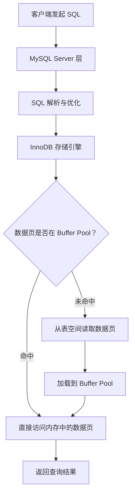
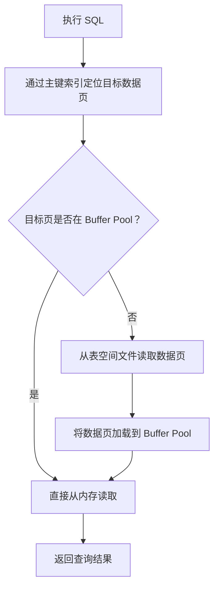
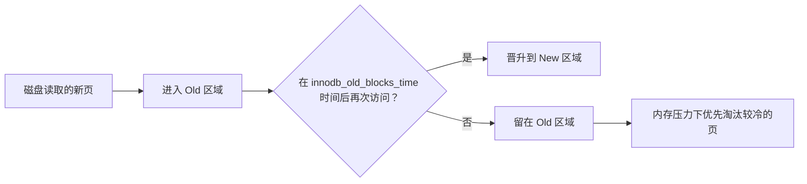
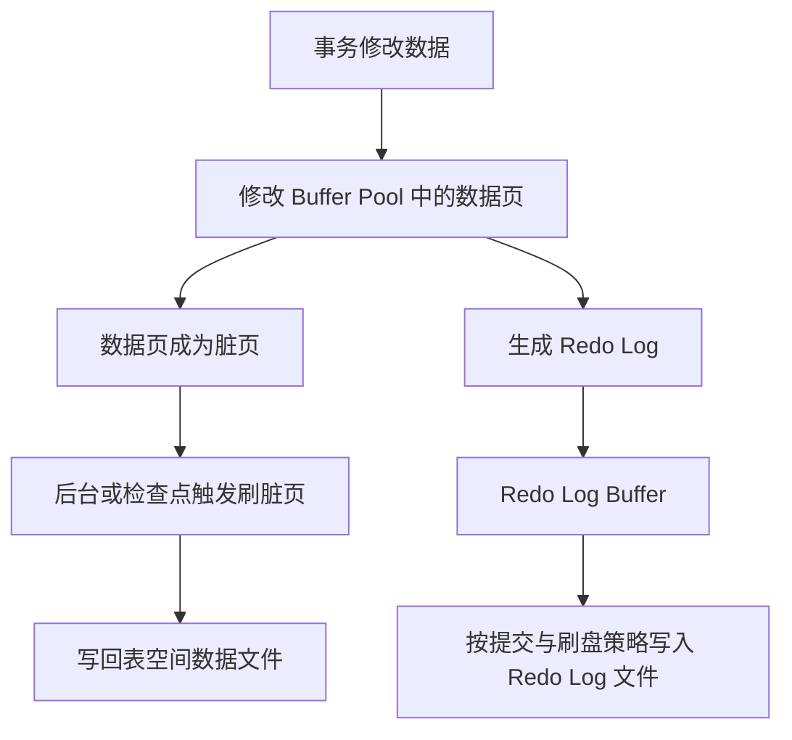
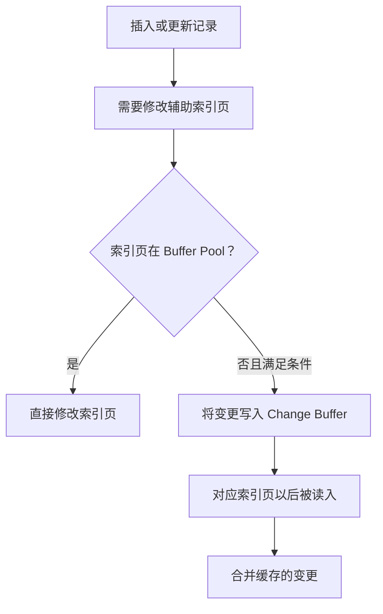

同一条 SQL，为什么第一次执行可能比较慢，第二次却快了不少？

很多时候，原因并不是 MySQL 记住了这条 SQL 的查询结果，而是它把这条 SQL 需要访问的数据页加载到了内存。下一次再访问时，就不必重新从磁盘读取。

在日常开发中，我们还经常听到这样的说法：

- MySQL 有缓存机制，查询过的数据会被缓存起来。
- 给 MySQL 分配更多内存，可以减少磁盘 IO。
- MySQL 8.0 已经移除了 Query Cache。

这些说法都没错，但它们容易让人产生一个疑问：**既然 MySQL 8.0 移除了查询缓存，为什么它仍然能够利用内存缓存数据？**

原因在于，MySQL 的缓存并不是一个单一的组件。不同层次、不同用途的缓存共同参与了 SQL 的执行过程。理解它们，不仅能解释数据库为什么越查越快，也能帮助我们判断：慢查询究竟是 SQL、索引、内存命中率，还是磁盘 I/O 的问题。

本文以 MySQL 8.x 和 InnoDB 为主线，适当对比 MySQL 5.7。先说结论：

> **现代 MySQL 最重要的缓存机制是 InnoDB Buffer Pool。它缓存的是数据页和索引页，而不是某条 SQL 的最终查询结果。**

## 一、为什么数据库需要缓存？

先思考一个简单的问题：执行一条 SQL，数据究竟从哪里来？

数据库中的数据最终存储在磁盘上。即使使用 SSD，磁盘 IO 的延迟通常也远高于内存访问。

如果每次查询都必须从磁盘读取数据，数据库的性能很容易受到存储设备的限制。

缓存的核心目的就是：**把更可能被再次访问的数据保留在更快的存储介质中，减少重复的慢速 IO。**

可以用一个简化的层次结构理解：



这里需要注意：缓存并不意味着数据库不再访问磁盘，而是尽可能减少访问磁盘的次数。

## 二、MySQL 的缓存并不只有一种

从架构上看，可以把 MySQL 中常见的缓存分为两类：

1. **Server 层缓存**：由 MySQL Server 管理，涉及连接线程、表定义、表打开状态、预处理语句等。
2. **存储引擎层缓存**：由具体存储引擎管理。对于 InnoDB 来说，最重要的就是 Buffer Pool。

从职责上看，常见机制可以整理成下表：

| 机制 | 所在层次 | 缓存内容与主要作用 |
| --- | --- | --- |
| Query Cache | Server 层（旧版本） | 缓存 SQL 结果集，MySQL 8.0 已移除 |
| Thread Cache | Server 层 | 复用连接处理线程，减少频繁创建和销毁线程的开销 |
| Table Open / Definition Cache | Server 层 | 缓存已打开的表对象和表定义，减少重复打开和解析的开销 |
| Prepared Statement Cache | Server 层 | 缓存预处理语句相关信息，减少重复解析和准备的开销 |
| Buffer Pool | InnoDB | 缓存数据页、索引页等，减少磁盘 IO |
| Adaptive Hash Index | InnoDB | 为部分热点索引访问建立哈希结构 |
| Change Buffer | InnoDB | 缓存部分辅助索引页变更 |
| Log Buffer | InnoDB | 暂存 Redo Log，减少日志写入的零散开销 |

这些机制虽然都与"缓存"有关，但缓存对象、管理方式和生命周期并不相同。例如，Prepared Statement 可以在客户端会话或服务端范围内使用，不能简单理解成一个全局 SQL 结果缓存。

此外，操作系统也会利用文件系统缓存，应用程序还可能在 MySQL 外部使用 Redis 等缓存系统。这些都不应该与 InnoDB Buffer Pool 混为一谈（第九节会专门对比）。

接下来重点看最核心的 Buffer Pool，先从被移除的 Query Cache 说起。

## 三、Query Cache：曾经的查询结果缓存

Query Cache 是 MySQL 早期提供的一种查询缓存机制。

它的思路非常直接：

- 缓存 SQL 语句及其对应的查询结果。
- 当收到符合缓存条件的相同查询时，直接返回之前保存的结果。
- 当相关表发生数据变更时，失效对应的缓存结果。

例如：

```sql
SELECT name, age FROM user WHERE id = 100;
```

假设第一次执行时没有缓存，MySQL 正常查询并返回结果，同时将结果放入 Query Cache。

如果之后再次执行符合缓存条件的相同 SQL，就可能直接从 Query Cache 返回结果，而不必重新执行查询。

看起来很理想，但它存在一个比较严重的问题：**缓存失效与并发竞争的成本可能抵消缓存带来的收益。**

假设某张表有大量读请求，同时也存在频繁写入：

1. 读请求将查询结果放入缓存。
2. 写请求修改表中的数据。
3. 与该表相关的查询缓存需要失效。
4. 后续读请求重新执行查询并再次尝试缓存。

在高并发环境下，查询缓存的维护和同步可能带来额外开销。尤其是旧版本中，共享查询缓存还可能成为并发访问的瓶颈。

因此，Query Cache 从 MySQL 5.7.20 开始被标记为弃用，并在 MySQL 8.0 中正式移除。

这也解释了一个常见误区：

> **MySQL 8.0 中第二次查询更快，通常不能归功于 Query Cache。更常见的原因是 Buffer Pool、操作系统缓存、执行计划和其他运行时状态已经预热。**

注意：MySQL 8.0 移除的是 Query Cache，而不是所有缓存。InnoDB Buffer Pool 仍然是 MySQL 性能优化中非常重要的组成部分。

## 四、Buffer Pool：InnoDB 最重要的缓存

### 4.1 Buffer Pool 缓存的是什么？

如果说 Query Cache 缓存的是 SQL 查询结果，那么 Buffer Pool 缓存的就是 **InnoDB 从磁盘读取的数据页（Page）**。

这是两种完全不同的缓存思路。

InnoDB 在读取数据时，并不是简单地把查询结果保存起来，而是以数据页为单位，将磁盘中的数据页加载到内存。它缓存的不是某条 SQL 的结果集，而是 InnoDB 内部的数据结构，常见的有：

- 数据页：存放表记录。
- 索引页：B+Tree 的根节点、内部节点和叶子节点。
- Undo 页：与事务回滚和 MVCC 可见性判断相关。
- 其他 InnoDB 内部管理页。

InnoDB 默认页大小通常为 16KB，可以通过 `innodb_page_size` 查看；页大小在实例初始化时确定，并不是运行时随意修改的参数。

例如，一张表的数据分布在多个数据页中：

- 第一次查询某条记录时，相关数据页可能需要从磁盘读取。
- InnoDB 将数据页加载到 Buffer Pool。
- 后续查询如果访问同一个数据页，就可以直接从内存读取。

即使两条 SQL 的写法不同，只要它们最终访问了相同的数据页，也有机会复用 Buffer Pool 中已经加载的数据。这也是为什么 InnoDB Buffer Pool 比传统 Query Cache 更适合作为存储引擎层的基础缓存。

### 4.2 一次查询的完整过程

假设有一张用户表：

```sql
CREATE TABLE user (
    id BIGINT PRIMARY KEY,
    name VARCHAR(50),
    age INT
) ENGINE = InnoDB;
```

执行：

```sql
SELECT * FROM user WHERE id = 100;
```

简化后的过程如下：



第一次访问时，如果目标页不在 Buffer Pool，就需要发生物理读；加载后，后续访问同一个页通常可以直接从内存读取。

通过主键查询一条记录时，可能需要访问 B+Tree 的多个层级。只要这些索引页和目标数据页已经在 Buffer Pool 中，就能减少磁盘读取。

这也是为什么**索引优化和缓存命中并不是互相独立的两件事**：索引决定需要访问哪些页，Buffer Pool 决定这些页是否需要从存储设备读取。

### 4.3 逻辑读与物理读

这里有两个容易混淆的概念：

- **逻辑读**：请求访问 Buffer Pool 中的数据页，不代表一定发生磁盘 I/O。
- **物理读**：需要从存储设备读取数据页。实际底层还可能命中操作系统缓存，因此 MySQL 统计中的物理读不一定等于真正的设备 I/O。

### 4.4 Buffer Pool 的内部结构

Buffer Pool 并不是一个简单的 Map。它内部维护着多个数据页及其管理信息，可以简化理解为：

| 组成 | 作用 |
|---|---|
| 数据页 | 缓存从磁盘读取的 InnoDB 页面 |
| Page Hash | 根据页标识快速定位已经缓存的页面 |
| LRU List | 管理页面的访问热度与淘汰顺序 |
| Free List | 管理当前可供使用的空闲页面 |
| Flush List | 管理已经被修改、需要刷盘的脏页 |

它需要解决几个问题：如何判断一个数据页是否已经被缓存？内存空间有限，应该保留哪些数据页？缓存空间不足时，应该淘汰哪些数据页？数据被修改后，如何保证最终持久化到磁盘？

其中，LRU List 是理解 Buffer Pool 缓存淘汰策略的关键。

## 五、Buffer Pool 满了怎么办？——改进版 LRU

内存有限，不可能无限缓存所有数据页。InnoDB 使用改进的 LRU（Least Recently Used，最近最少使用）链表管理数据页。

### 5.1 普通 LRU 的思路

LRU 的核心思想是：

> 最近访问过的数据更有可能在近期再次被访问；长时间没有访问的数据，更适合被淘汰。

假设 Buffer Pool 只能容纳 5 个数据页：


此时如果需要加载 Page F，而内存空间已经不足，按照普通 LRU 的思路，最久未使用的 Page E 会被淘汰，新页放到链表头部。

### 5.2 为什么不直接使用普通 LRU？

考虑一个场景：执行一次大范围扫描：

```sql
SELECT * FROM orders;
```

大量只访问一次的数据页如果每次都放到 LRU 链表的头部，就可能挤掉原本经常访问的热点页面。这就是所谓的缓存污染（Cache Pollution）。

### 5.3 中点插入策略（Midpoint Insertion）

InnoDB 为了解决这个问题，将 LRU 链表分为两个区域：

- **New Sublist（新生代/热数据区）**：靠近链表头部，存放较热的数据页。
- **Old Sublist（老年代/冷数据区）**：靠近链表尾部，新加载或相对不活跃的数据页先进入这里。

新读取的数据页默认插入到 Old Sublist 的头部（即整个链表的中点附近），而不是整个 LRU 链表的头部：


当 Old Sublist 中的页面再次被访问，并且满足一定条件后，才会被提升到 New Sublist：



这种机制能够有效降低全表扫描等操作对热点数据的影响。

相关参数：

```sql
SHOW VARIABLES LIKE 'innodb_old_blocks_pct';
SHOW VARIABLES LIKE 'innodb_old_blocks_time';
```

其中：

- `innodb_old_blocks_pct`：Old Sublist 占整个 LRU 链表的比例，默认通常为 37%（约 3/8）。
- `innodb_old_blocks_time`：页面进入 Old Sublist 后，需要经过多长时间再次访问，才允许其提升到 New Sublist，默认值通常为 1000 毫秒。

注意：LRU 管理的是页，不是业务记录；页面是否被淘汰，还会受到脏页、固定页以及其他内部状态影响。

## 六、脏页与刷盘：修改数据不一定立即写回

读缓存只是故事的一半。缓存数据并不意味着所有操作都只发生在内存中。

假设我们执行：

```sql
UPDATE user SET age = 30 WHERE id = 100;
```

InnoDB 找到对应的数据页，将修改应用到内存中的页面。

此时，内存中的页面已经发生变化，但磁盘上的数据页不一定立即更新。

**内存中已经被修改、但尚未写入磁盘的数据页，就是脏页（Dirty Page）。**

InnoDB 会通过后台刷盘机制，将脏页逐步写入磁盘。

这里还涉及一个重要机制：Redo Log。

事务修改数据时，InnoDB 会按照 WAL（Write-Ahead Logging，预写日志）原则，先保证相关 Redo Log 持久化条件得到满足，再允许事务提交；数据页本身可以在之后通过后台刷盘写回数据文件。



这就是为什么事务提交成功，并不意味着每个被修改的数据页都已经立即写回数据文件。Redo Log 的持久化与数据页刷盘是两个不同的过程，这也是数据库能够兼顾性能与崩溃恢复能力的重要原因。

这部分还会涉及 Undo Log、Checkpoint、崩溃恢复和事务隔离，值得单独展开。不要把"Buffer Pool 命中"与"数据已经持久化"画等号。

## 七、InnoDB 还有哪些值得了解的缓存机制？

### 7.1 Adaptive Hash Index：自适应哈希索引

InnoDB 的主要索引结构是 B+Tree。对于某些访问模式稳定、反复访问相同索引页的场景，InnoDB 可以根据访问情况，在 Buffer Pool 中已经存在的索引页之上建立自适应哈希索引（AHI）。

它相当于在 B+Tree 之上增加一条可能更快的查找路径，让符合条件的高频等值查找可以通过哈希结构定位，而不必每次都从 B+Tree 根节点开始。

它不是缓存查询结果，不是用户创建的普通索引，也不是对整张表自动建立哈希索引，而是 InnoDB 根据运行时访问情况建立的辅助结构。是否有效取决于工作负载；在某些并发场景下，它也可能带来额外的维护和竞争开销。

可以查看：

```sql
SHOW VARIABLES LIKE 'innodb_adaptive_hash_index';
```

不要为了"开启缓存"就盲目启用它，应结合实际访问模式和性能指标测试。

### 7.2 Change Buffer：更改缓冲区

Change Buffer 主要优化辅助索引的写入。

假设插入一条订单记录，需要更新某个二级索引，但对应的索引页当前不在 Buffer Pool 中。如果此时为了修改索引而立刻把页面从磁盘读入，可能产生额外的随机 I/O。

在满足条件时，InnoDB 可以先把对该索引页的变更记录在 Change Buffer 中。等对应页面以后被读入 Buffer Pool 时，再把这些变更合并进去。



它不是所有索引写入都会经过的通用队列，也不适用于所有索引类型和操作。其价值在于特定场景下合并随机 I/O。

### 7.3 Log Buffer：日志缓冲区

Log Buffer 用来暂存 Redo Log。事务修改数据页时，相关 redo 记录先进入日志缓冲区，再根据刷盘策略写入 Redo Log 文件。

它的目标不是缓存查询结果，而是降低日志写入的开销，并配合 WAL 机制保障崩溃恢复能力。

例如：

```sql
SHOW VARIABLES LIKE 'innodb_log_buffer_size';
SHOW VARIABLES LIKE 'innodb_flush_log_at_trx_commit';
```

这里要区分：Log Buffer 是内存中的日志缓冲；Redo Log 文件是持久化日志。两者不能混为一谈。

## 八、如何观察和评估 Buffer Pool？

了解原理之后，我们可以通过 MySQL 提供的状态变量观察缓存效果。

### 8.1 查看 Buffer Pool 配置

```sql
SHOW VARIABLES LIKE 'innodb_buffer_pool_size';
SHOW VARIABLES LIKE 'innodb_buffer_pool_instances';
```

其中：

- `innodb_buffer_pool_size`：Buffer Pool 的总容量。
- `innodb_buffer_pool_instances`：Buffer Pool 实例数量（在适用版本和配置下）。

### 8.2 查看缓存命中相关指标

```sql
SHOW GLOBAL STATUS LIKE 'Innodb_buffer_pool_read%';
```

重点关注：

- `Innodb_buffer_pool_read_requests`：逻辑读请求次数，也就是从 Buffer Pool 请求读取页面的次数。
- `Innodb_buffer_pool_reads`：无法直接从 Buffer Pool 满足、需要从磁盘读取页面的次数。

可以用下面的公式粗略计算 Buffer Pool 命中率：

```text
命中率 = 1 - Innodb_buffer_pool_reads
           / Innodb_buffer_pool_read_requests

命中率百分比 = 命中率 × 100%
```

例如，假设某个统计周期内：

- 逻辑读请求：1,000,000 次
- 需要从磁盘读取：10,000 次

那么：

```text
命中率 = 1 - 10,000 / 1,000,000
       = 99%
```

这说明绝大部分页面读取请求都由 Buffer Pool 满足。

不过，需要特别注意：这些是累计状态计数器。实际监控时，更应该在两个时间点采集数据，计算统计周期内的增量，而不是只看 MySQL 启动以来的累计值。

此外，命中率高并不意味着 SQL 一定很快。一个低效查询即使全部命中 Buffer Pool，也可能因为扫描了大量数据页、排序、锁等待等原因而很慢。缓存只是性能的一部分。

### 8.3 查看 Buffer Pool 的页面状态

```sql
SHOW ENGINE INNODB STATUS\G
```

可以查看 InnoDB 当前运行状态，其中包含 Buffer Pool、页面读取、脏页、IO 等相关信息。

在支持相关 Information Schema 视图的版本中，也可以查看：

```sql
SELECT
    POOL_ID,
    POOL_SIZE,
    FREE_BUFFERS,
    DATABASE_PAGES,
    MODIFIED_DATABASE_PAGES,
    PENDING_READS,
    PENDING_FLUSH_LRU,
    PENDING_FLUSH_LIST
FROM information_schema.INNODB_BUFFER_POOL_STATS;
```

通过这些指标，可以进一步了解空闲页面、脏页以及待处理 IO 的情况。

### 8.4 Buffer Pool 应该设置多大？

这是实际部署 MySQL 时经常遇到的问题。

很多教程会建议将 Buffer Pool 设置为物理内存的 60%～80%，但这只是常见的经验范围，并不是固定规则。

例如，一台专门运行 MySQL 的 16GB 服务器，可以将 10GB～12GB 作为初始评估范围，再结合实际负载进行调整。

但如果 MySQL 与应用服务、Redis、其他进程部署在同一台机器上，就必须考虑其他服务的内存需求。Buffer Pool 并不是越大越好，需要为操作系统、连接、排序、临时表以及其他内存分配留出空间。

建议按照以下思路进行优化：

1. 先了解服务器的物理内存和其他进程的内存占用。
2. 观察 Buffer Pool 的命中率、空闲页面和脏页数量。
3. 结合磁盘 IO、慢 SQL 和业务访问模式判断瓶颈。
4. 在业务低峰期逐步调整配置。
5. 观察调整前后的性能变化，而不是只看单一命中率指标。

在支持动态调整的版本中，可以通过以下方式修改：

```sql
SET GLOBAL innodb_buffer_pool_size = 10737418240;
```

这里的数值单位是 Byte，即 10GiB。

生产环境调整前，需要确认具体 MySQL 版本、动态调整限制和实例资源情况，并做好变更评估。

## 九、Buffer Pool、操作系统 Page Cache 和 Redis 的区别

这三个概念经常被放在一起讨论，但它们位于不同层次。

### 9.1 Buffer Pool 与操作系统 Page Cache

Buffer Pool 是 InnoDB 自己管理的内存缓存，理解表页、索引页以及脏页状态。

操作系统 Page Cache 则由操作系统内核管理，缓存文件内容。即使 InnoDB 需要读取表空间文件，底层文件读取也可能命中操作系统 Page Cache，而不一定真正访问磁盘设备。

因此，MySQL 的物理读计数和设备层面的实际磁盘读取量并不总是一一对应。

可以粗略理解为：


这也带来一个现实问题：内存可能在数据库缓存和操作系统缓存之间重复占用。数据库部署时需要结合存储引擎、操作系统、内存大小和 I/O 配置进行权衡。

### 9.2 Buffer Pool 与 Redis

Buffer Pool 缓存的是数据库内部的数据页；Redis 缓存的是应用主动写入的 Key-Value 数据。

以用户信息接口为例，对比增加 Redis 前后的请求路径：


即使 MySQL 的 Buffer Pool 命中，应用依然需要访问 MySQL，数据库仍然要处理 SQL、事务、权限、网络协议和结果返回。Redis 命中则可以在应用层提前结束这次数据库访问。

| 对比 | InnoDB Buffer Pool | Redis |
| --- | --- | --- |
| 缓存对象 | 数据页、索引页等 | Key-Value |
| 管理者 | InnoDB | Redis 服务 |
| 使用方式 | 数据库内部自动管理 | 通常由业务代码读写 |
| 主要目标 | 减少数据页读取 I/O | 减少数据库访问与计算 |
| 一致性 | 由数据库事务和存储引擎保证 | 需要业务设计缓存更新/失效策略 |

Redis 也不是"加上就一定更快"。缓存穿透、击穿、雪崩、双写一致性、过期策略和热点 Key 都需要设计。只有访问模式和一致性要求适合时，才值得引入。

## 十、实际排查时应该关注什么？

当你发现 MySQL 查询变慢，可以按下面的顺序排查：

1. **先看 SQL 和执行计划**：使用 `EXPLAIN` 或 `EXPLAIN ANALYZE`，确认扫描行数、索引选择、排序和回表情况。
2. **再看 Buffer Pool**：检查 `Innodb_buffer_pool_read_requests` 与 `Innodb_buffer_pool_reads` 的增量，判断是否出现大量数据页读取。
3. **看内存是否合理**：确认 `innodb_buffer_pool_size`，观察实例是否有内存压力，避免为了提高命中率无限扩大缓冲池。
4. **观察 I/O 与等待**：结合操作系统磁盘延迟、吞吐量、InnoDB 等待事件和慢查询日志，区分真正的存储瓶颈。
5. **最后考虑应用层缓存**：如果查询结果重复读取、允许一定程度的数据延迟，并且业务能承担一致性复杂度，再评估 Redis。

常用查看命令：

```sql
-- Buffer Pool 大小
SHOW VARIABLES LIKE 'innodb_buffer_pool_size';

-- Buffer Pool 读相关统计
SHOW GLOBAL STATUS LIKE 'Innodb_buffer_pool_read%';

-- InnoDB 状态摘要
SHOW ENGINE INNODB STATUS;
```

这些指标需要结合时间窗口、业务流量和 SQL 类型分析。不要只因为命中率不是 99.9%，就立即认定 Buffer Pool 太小；也不要只因为命中率很高，就认为数据库没有性能问题。

## 十一、常见误区

最后总结几个容易混淆的知识点。

**误区一：MySQL 8.0 没有缓存机制了。**

错误。MySQL 8.0 移除的是 Query Cache，InnoDB Buffer Pool 依然存在，而且它是 InnoDB 最重要的内存缓存机制之一。

**误区二：MySQL 缓存的是 SQL 执行结果。**

不完全正确。Query Cache 曾经缓存查询结果；InnoDB Buffer Pool 缓存的是数据页、索引页等页面。两者不能混为一谈。

**误区三：缓存命中率越高，SQL 就越快。**

错误。缓存命中率只是一个观察指标。SQL 是否高效，还取决于索引设计、执行计划、扫描行数、锁等待、排序和网络开销等因素。

**误区四：事务提交就意味着数据页已经写入磁盘。**

错误。事务提交时需要满足 Redo Log 的持久化要求，但脏数据页可以由后台线程稍后刷盘。

**误区五：Buffer Pool 越大越好。**

错误。过大的 Buffer Pool 可能挤占系统和其他服务所需内存，最终反而影响整体稳定性。

## 十二、总结

回到最初的问题：为什么同一条 SQL 第二次执行可能更快？MySQL 8.0 移除了 Query Cache，为什么依然能够高效地处理重复查询？

因为第一次执行可能把所需的数据页和索引页加载进 Buffer Pool；后续访问可以复用这些内存页，减少数据文件读取。MySQL 的性能并不依赖于缓存 SQL 查询结果。但这并不意味着 MySQL 缓存了 SQL 结果，也不意味着所有后续执行都一定更快。

这篇文章最值得记住的几个概念：

| 概念 | 一句话理解 |
|---|---|
| Query Cache | 旧版本中的 SQL 查询结果缓存，MySQL 8.0 已移除 |
| Buffer Pool | InnoDB 最核心的页面缓存，缓存数据页和索引页 |
| LRU | 管理页面访问热度和淘汰顺序的机制 |
| Midpoint Insertion | InnoDB 改进 LRU、降低全表扫描缓存污染的策略 |
| Dirty Page | 已修改但尚未写回数据文件的页面 |
| Redo Log | 保障事务持久性和崩溃恢复的重要日志机制 |
| Adaptive Hash Index | 基于访问模式建立的辅助哈希索引 |
| Change Buffer | 在符合条件时暂存辅助索引变更 |
| Log Buffer | 暂存 Redo Log，不是查询结果缓存 |
| Redis | 应用层缓存 Key-Value，与数据库内部页缓存解决的是不同问题 |

理解缓存机制之后，再去看 MySQL 的索引、事务、Redo Log、磁盘 IO 和 SQL 执行计划，就能把这些原本分散的知识点串联起来。真正理解 MySQL 缓存，不是记住几个名词，而是建立从 SQL、索引、数据页、内存、文件系统到持久化日志的完整链路。

**数据库性能优化不是简单地增加缓存，而是理解数据从磁盘进入内存、被访问、被修改，最终持久化到磁盘的完整过程。**

## 参考资料

- [MySQL 8.4 Reference Manual - InnoDB Buffer Pool](https://dev.mysql.com/doc/refman/8.4/en/innodb-buffer-pool.html)
- [MySQL 8.4 Reference Manual - The InnoDB Buffer Pool LRU Algorithm](https://dev.mysql.com/doc/refman/8.4/en/innodb-buffer-pool.html#innodb-buffer-pool-lru-list)
- [MySQL 8.4 Reference Manual - InnoDB Change Buffer](https://dev.mysql.com/doc/refman/8.4/en/innodb-change-buffer.html)
- [MySQL 8.4 Reference Manual - Adaptive Hash Index](https://dev.mysql.com/doc/refman/8.4/en/innodb-adaptive-hash.html)
- [MySQL 8.4 Reference Manual - InnoDB Redo Log](https://dev.mysql.com/doc/refman/8.4/en/innodb-redo-log.html)
- [MySQL 8.0 Reference Manual - Buffering and Caching](https://dev.mysql.com/doc/refman/8.0/en/buffering-caching.html)
- [MySQL 8.0 Reference Manual - Features Removed in MySQL 8.0](https://dev.mysql.com/doc/refman/8.0/en/added-deprecated-removed.html)
- [MySQL 5.7 Reference Manual - The Query Cache](https://dev.mysql.com/doc/refman/5.7/en/query-cache.html)