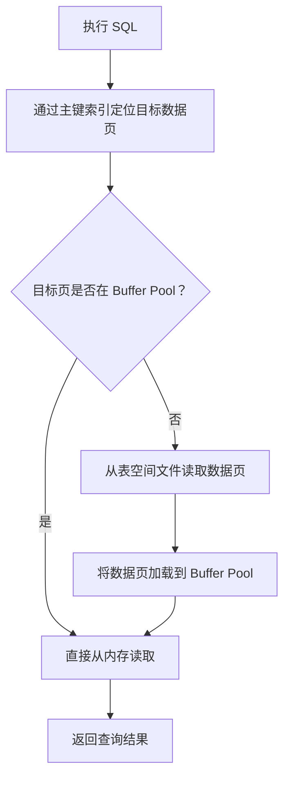
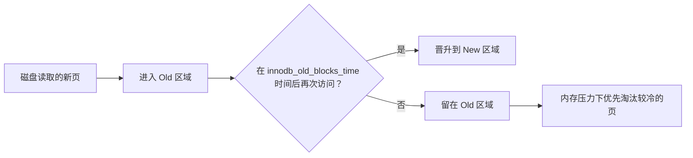
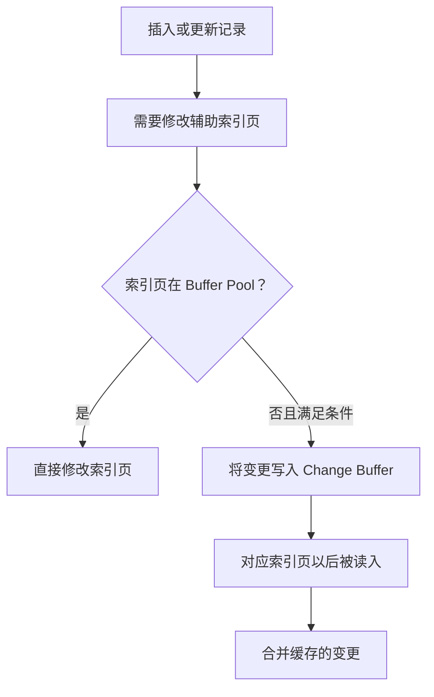
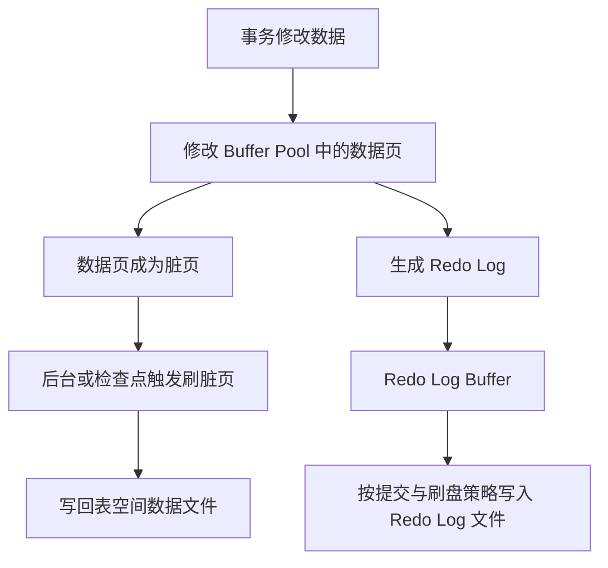

同一条 SQL，为什么第一次执行可能比较慢，第二次却快了不少？

很多时候，原因并不是 MySQL 记住了这条 SQL 的查询结果，而是它把这条 SQL 需要访问的数据页加载到了内存。下一次再访问时，就不必重新从磁盘读取。

这背后涉及 MySQL 的多层缓存机制。理解它们，不仅能解释数据库为什么越查越快，也能帮助我们判断：慢查询究竟是 SQL、索引、内存命中率，还是磁盘 I/O 的问题。

本文主要以 MySQL 8.x 和 InnoDB 为背景。先说结论：

> **现代 MySQL 最重要的缓存机制是 InnoDB Buffer Pool。它缓存的是数据页和索引页，而不是某条 SQL 的最终查询结果。**

## 一、MySQL 的缓存并不只有一种

从职责上看，可以把常见机制分成几类：

| 机制 | 所在层次 | 主要作用 |
| --- | --- | --- |
| Query Cache | Server 层（旧版本） | 缓存 SQL 结果集，MySQL 8.0 已移除 |
| Thread Cache | Server 层 | 复用连接处理线程 |
| Table Cache | Server 层 | 缓存打开的表对象及表定义相关信息 |
| Buffer Pool | InnoDB | 缓存数据页、索引页等 |
| Adaptive Hash Index | InnoDB | 为部分热点索引访问建立哈希结构 |
| Change Buffer | InnoDB | 缓存部分辅助索引页变更 |
| Log Buffer | InnoDB | 暂存 Redo Log，减少日志写入的零散开销 |

这些机制虽然都与“缓存”有关，但缓存对象和解决的问题并不相同。接下来重点看最核心的 Buffer Pool。

## 二、Buffer Pool：InnoDB 最重要的内存区域

### 1. 为什么需要 Buffer Pool？

磁盘和内存的访问延迟差距很大。如果每次查询都直接从磁盘读取数据，数据库很难获得理想的吞吐量。

InnoDB 因此在自己的内存中维护了一块区域：**Buffer Pool（缓冲池）**。它缓存数据库文件中的数据页，让后续访问尽可能在内存中完成。

InnoDB 默认页大小通常为 16KB，可以通过 `innodb_page_size` 查看；页大小在实例初始化时确定，并不是运行时随意修改的参数。

假设有一张用户表：

```sql
CREATE TABLE user (
    id BIGINT PRIMARY KEY,
    name VARCHAR(50),
    age INT
) ENGINE = InnoDB;
```

执行：

```sql
SELECT * FROM user WHERE id = 100;
```

简化后的过程如下：



第一次访问时，如果目标页不在 Buffer Pool，就需要发生物理读；加载后，后续访问同一个页通常可以直接从内存读取。

这里有两个容易混淆的概念：

- **逻辑读**：请求访问 Buffer Pool 中的数据页，不代表一定发生磁盘 I/O。
- **物理读**：需要从存储设备读取数据页。实际底层还可能命中操作系统缓存，因此 MySQL 统计中的物理读不一定等于真正的设备 I/O。

### 2. Buffer Pool 缓存的是什么？

它不是把一条 SQL 的结果集存起来，而是以页为单位缓存 InnoDB 内部的数据结构，常见的有：

- 数据页：存放表记录。
- 索引页：B+Tree 的根节点、内部节点和叶子节点。
- Undo 页：与事务回滚和 MVCC 可见性判断相关。
- 其他 InnoDB 内部管理页。

例如，通过主键查询一条记录时，可能需要访问 B+Tree 的多个层级。只要这些索引页和目标数据页已经在 Buffer Pool 中，就能减少磁盘读取。

这也是为什么**索引优化和缓存命中并不是互相独立的两件事**：索引决定需要访问哪些页，Buffer Pool 决定这些页是否需要从存储设备读取。

### 3. Buffer Pool 满了怎么办？——改进版 LRU

内存有限，不可能无限缓存所有数据页。InnoDB 使用改进的 LRU（Least Recently Used，最近最少使用）链表管理数据页。

普通 LRU 有一个问题：假设执行一次大范围扫描：

```sql
SELECT * FROM orders;
```

大量只访问一次的数据页可能挤掉原本频繁使用的热点页。

InnoDB 因此采用了 midpoint insertion 策略，将 LRU 链表划分为两个区域：

- **New Sublist（新/热数据区）**：靠近链表头部，存放较热的数据页。
- **Old Sublist（旧/冷数据区）**：靠近链表尾部，新加载的数据页通常先进入这里。

默认情况下，Old 区域约占整个 LRU 链表的 3/8。新页进入 Old 区域后，如果在一定时间后再次被访问，就有机会晋升到 New 区域；否则，它更容易在内存紧张时被淘汰。



`innodb_old_blocks_time` 用于控制页在 Old 区域停留多久后才允许因再次访问而晋升，默认值通常为 1000 毫秒。它可以减少全表扫描对热点缓存的污染。

注意：LRU 管理的是页，不是业务记录；页面是否被淘汰，还会受到脏页、固定页以及其他内部状态影响。

### 4. 如何查看和评估 Buffer Pool？

先查看配置：

```sql
SHOW VARIABLES LIKE 'innodb_buffer_pool_size';
SHOW VARIABLES LIKE 'innodb_buffer_pool_instances';
```

再观察状态计数器：

```sql
SHOW GLOBAL STATUS LIKE 'Innodb_buffer_pool_read%';
```

常见指标：

- `Innodb_buffer_pool_read_requests`：逻辑读请求次数。
- `Innodb_buffer_pool_reads`：InnoDB 无法直接从 Buffer Pool 满足请求、需要读取数据页的次数。

可以用下面的公式粗略估算命中率：

```text
命中率 ≈ 1 - Innodb_buffer_pool_reads
             / Innodb_buffer_pool_read_requests
```

实际监控时，更建议采集一段时间内两个计数器的增量，而不是只看实例启动以来的累计值。

还要注意：命中率高不代表 SQL 一定快。一次查询即使全部命中内存，也可能扫描了大量无用记录、发生锁等待，或者执行了昂贵的排序和计算。缓存只是性能的一部分。

## 三、InnoDB 还有哪些值得了解的缓存机制？

### 1. Adaptive Hash Index：自适应哈希索引

InnoDB 的主要索引结构是 B+Tree。对于某些访问模式稳定、反复访问相同索引页的场景，InnoDB 可以根据访问情况构建自适应哈希索引。

它相当于在 B+Tree 之上增加一条可能更快的查找路径，让符合条件的查找可以通过哈希结构定位，而不必每次都从 B+Tree 根节点开始。

它不是用户创建的普通索引，也不是对整张表自动建立哈希索引。是否有效取决于工作负载；在某些并发场景下，它也可能带来额外的维护和竞争开销。

可以查看：

```sql
SHOW VARIABLES LIKE 'innodb_adaptive_hash_index';
```

不要为了“开启缓存”就盲目启用它，应结合实际访问模式和性能指标测试。

### 2. Change Buffer：更改缓冲区

Change Buffer 主要优化辅助索引的写入。

假设插入一条订单记录，需要更新某个二级索引，但对应的索引页当前不在 Buffer Pool 中。如果此时为了修改索引而立刻把页面从磁盘读入，可能产生额外的随机 I/O。

在满足条件时，InnoDB 可以先把对该索引页的变更记录在 Change Buffer 中。等对应页面以后被读入 Buffer Pool 时，再把这些变更合并进去。



它不是所有索引写入都会经过的通用队列，也不适用于所有索引类型和操作。其价值在于特定场景下合并随机 I/O。

### 3. Log Buffer：日志缓冲区

Log Buffer 用来暂存 Redo Log。事务修改数据页时，相关 redo 记录先进入日志缓冲区，再根据刷盘策略写入 Redo Log 文件。

它的目标不是缓存查询结果，而是降低日志写入的开销，并配合 WAL（Write-Ahead Logging，预写日志）机制保障崩溃恢复能力。

例如：

```sql
SHOW VARIABLES LIKE 'innodb_log_buffer_size';
SHOW VARIABLES LIKE 'innodb_flush_log_at_trx_commit';
```

这里要区分：Log Buffer 是内存中的日志缓冲；Redo Log 文件是持久化日志。两者不能混为一谈。

## 四、MySQL 8.0 为什么没有 Query Cache 了？

早期 MySQL 提供过 Query Cache（查询缓存）。它缓存的是 SQL 对应的结果集。

例如：

```sql
SELECT * FROM user WHERE id = 100;
```

如果再次执行完全匹配且缓存有效的查询，理论上可以直接返回之前缓存的结果。

听起来很理想，但问题在于：当相关表发生数据修改时，依赖这些表的查询缓存结果需要失效。高并发读写场景中，缓存维护和失效带来的成本可能抵消收益，甚至成为性能瓶颈。

因此，MySQL 5.7 中 Query Cache 已被弃用，MySQL 8.0 将其彻底移除。

这也解释了一个常见误区：

> **MySQL 8.0 中第二次查询更快，通常不能归功于 Query Cache。更常见的原因是 Buffer Pool、操作系统缓存、执行计划和其他运行时状态已经预热。**

## 五、MySQL Buffer Pool、操作系统 Page Cache 和 Redis 有什么区别？

这三个概念经常被放在一起讨论，但它们位于不同层次。

### 1. Buffer Pool 与操作系统 Page Cache

Buffer Pool 是 InnoDB 自己管理的内存缓存，理解表页、索引页以及脏页状态。

操作系统 Page Cache 则由操作系统内核管理，缓存文件内容。即使 InnoDB 需要读取表空间文件，底层文件读取也可能命中操作系统 Page Cache，而不一定真正访问磁盘设备。

因此，MySQL 的物理读计数和设备层面的实际磁盘读取量并不总是一一对应。

可以粗略理解为：

```text
InnoDB 查询
   ↓
Buffer Pool（数据库管理的数据页缓存）
   ↓ 未命中
文件系统读取
   ↓
操作系统 Page Cache（文件页缓存）
   ↓ 未命中
存储设备
```

这也带来一个现实问题：内存可能在数据库缓存和操作系统缓存之间重复占用。数据库部署时需要结合存储引擎、操作系统、内存大小和 I/O 配置进行权衡。

### 2. Buffer Pool 与 Redis

Buffer Pool 缓存的是数据库内部的数据页；Redis 缓存的是应用主动写入的 Key-Value 数据。

以用户信息接口为例：

没有 Redis 时：

```text
客户端
  ↓
应用服务
  ↓
MySQL
  ↓
Buffer Pool
  ↓
返回结果
```

增加 Redis 后：

```text
客户端
  ↓
应用服务
  ↓
Redis
  ├── 命中：直接返回
  └── 未命中
        ↓
       MySQL
        ↓
     Buffer Pool
        ↓
     返回结果
        ↓
     回填 Redis
```

即使 MySQL 的 Buffer Pool 命中，应用依然需要访问 MySQL，数据库仍然要处理 SQL、事务、权限、网络协议和结果返回。Redis 命中则可以在应用层提前结束这次数据库访问。

| 对比 | InnoDB Buffer Pool | Redis |
| --- | --- | --- |
| 缓存对象 | 数据页、索引页等 | Key-Value |
| 管理者 | InnoDB | Redis 服务 |
| 使用方式 | 数据库内部自动管理 | 通常由业务代码读写 |
| 主要目标 | 减少数据页读取 I/O | 减少数据库访问与计算 |
| 一致性 | 由数据库事务和存储引擎保证 | 需要业务设计缓存更新/失效策略 |

Redis 也不是“加上就一定更快”。缓存穿透、击穿、雪崩、双写一致性、过期策略和热点 Key 都需要设计。只有访问模式和一致性要求适合时，才值得引入。

## 六、缓存与数据持久化：为什么修改数据不一定立即写回数据文件？

读缓存只是故事的一半。InnoDB 修改数据时，通常先修改 Buffer Pool 中的数据页，这些被修改过、尚未刷回数据文件的页称为脏页（Dirty Page）。

为了保证崩溃恢复能力，InnoDB 使用 Redo Log，并遵循 WAL 思想：相关 redo 日志需要先满足持久化要求，数据页可以在之后再刷回表空间文件。

简化理解：



这就是为什么事务提交成功，并不意味着每个被修改的数据页都已经立即写回数据文件。Redo Log 的持久化与数据页刷盘是两个不同的过程。

这部分还会涉及 Undo Log、Checkpoint、崩溃恢复和事务隔离，值得单独展开。不要把“Buffer Pool 命中”与“数据已经持久化”画等号。

## 七、实际排查时应该关注什么？

当你发现 MySQL 查询变慢，可以按下面的顺序排查：

1. **先看 SQL 和执行计划**：使用 `EXPLAIN` 或 `EXPLAIN ANALYZE`，确认扫描行数、索引选择、排序和回表情况。
2. **再看 Buffer Pool**：检查 `Innodb_buffer_pool_read_requests` 与 `Innodb_buffer_pool_reads` 的增量，判断是否出现大量数据页读取。
3. **看内存是否合理**：确认 `innodb_buffer_pool_size`，观察实例是否有内存压力，避免为了提高命中率无限扩大缓冲池。
4. **观察 I/O 与等待**：结合操作系统磁盘延迟、吞吐量、InnoDB 等待事件和慢查询日志，区分真正的存储瓶颈。
5. **最后考虑应用层缓存**：如果查询结果重复读取、允许一定程度的数据延迟，并且业务能承担一致性复杂度，再评估 Redis。

常用查看命令：

```sql
-- Buffer Pool 大小
SHOW VARIABLES LIKE 'innodb_buffer_pool_size';

-- Buffer Pool 读相关统计
SHOW GLOBAL STATUS LIKE 'Innodb_buffer_pool_read%';

-- InnoDB 状态摘要
SHOW ENGINE INNODB STATUS;
```

这些指标需要结合时间窗口、业务流量和 SQL 类型分析。不要只因为命中率不是 99.9%，就立即认定 Buffer Pool 太小；也不要只因为命中率很高，就认为数据库没有性能问题。

## 八、总结：理解缓存，先分清缓存的是什么

回到最初的问题：为什么同一条 SQL 第二次执行可能更快？

因为第一次执行可能把所需的数据页和索引页加载进 Buffer Pool；后续访问可以复用这些内存页，减少数据文件读取。但这并不意味着 MySQL 缓存了 SQL 结果，也不意味着所有后续执行都一定更快。

可以记住这几个要点：

- **Query Cache**：缓存查询结果，MySQL 8.0 已移除。
- **Buffer Pool**：缓存 InnoDB 数据页和索引页，是最重要的内存缓存。
- **LRU**：管理 Buffer Pool 中数据页的冷热与淘汰。
- **Adaptive Hash Index**：为部分热点索引访问提供额外的哈希查找路径。
- **Change Buffer**：在符合条件时暂存辅助索引变更。
- **Log Buffer**：暂存 Redo Log，不是查询结果缓存。
- **Redis**：应用层缓存 Key-Value，与数据库内部页缓存解决的是不同问题。

真正理解 MySQL 缓存，不是记住几个名词，而是建立从 SQL、索引、数据页、内存、文件系统到持久化日志的完整链路。

## 参考资料

- [MySQL 8.4 Reference Manual：InnoDB Buffer Pool](https://dev.mysql.com/doc/refman/8.4/en/innodb-buffer-pool.html)
- [MySQL 8.4 Reference Manual：The InnoDB Buffer Pool LRU Algorithm](https://dev.mysql.com/doc/refman/8.4/en/innodb-buffer-pool.html#innodb-buffer-pool-lru-list)
- [MySQL 8.4 Reference Manual：InnoDB Change Buffer](https://dev.mysql.com/doc/refman/8.4/en/innodb-change-buffer.html)
- [MySQL 8.4 Reference Manual：Adaptive Hash Index](https://dev.mysql.com/doc/refman/8.4/en/innodb-adaptive-hash.html)
- [MySQL 8.0 Reference Manual：The Query Cache](https://dev.mysql.com/doc/refman/8.0/en/query-cache.html)
- [MySQL 8.4 Reference Manual：InnoDB Redo Log](https://dev.mysql.com/doc/refman/8.4/en/innodb-redo-log.html)
