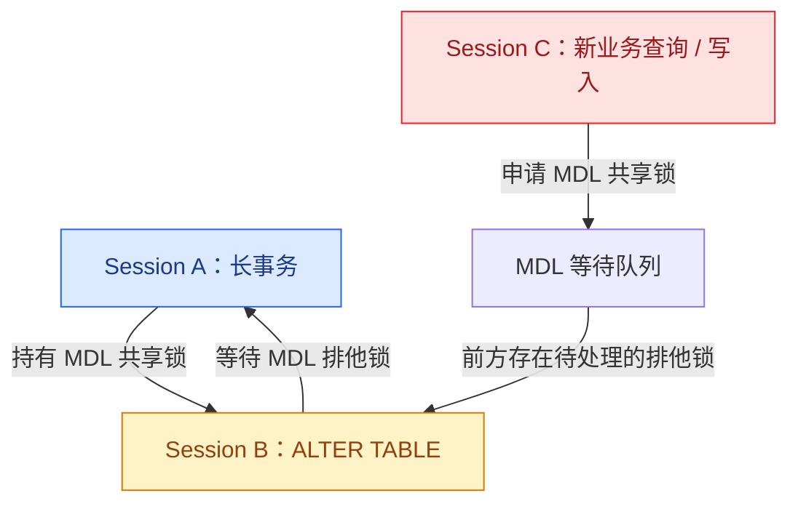

给一张千万级的大表增加索引，通常会让人想到一个关键词：**Online DDL**。

既然是在线 DDL，理论上就应该允许业务继续读写。于是我们执行了这样的语句：

```sql
ALTER TABLE orders
ADD INDEX idx_user_id (user_id),
ALGORITHM=INPLACE,
LOCK=NONE;
```

索引创建过程中看起来一切正常，但某个阶段业务写入突然开始排队，接口响应时间飙升，甚至连普通查询也被堵住。

问题来了：明明指定了 `LOCK=NONE`，为什么还是会发生锁等待？

答案是：**Online DDL 并不意味着完全不加锁。它尽可能减少 DDL 执行期间对并发读写的限制，但仍然需要通过 MDL（Metadata Lock，元数据锁）保护表定义的一致性。**

本文以 MySQL 8.0 和 InnoDB 为背景，拆解这个很容易在生产环境中踩到的坑。

## 一、先理解 MDL：它保护的不是数据行，而是对象定义

MDL 全称 Metadata Lock，中文通常称为元数据锁。

它由 MySQL Server 层管理，主要用于协调数据库对象的并发访问，避免一个会话正在使用表时，另一个会话随意修改或删除表结构。

例如：

```sql
-- 会话 A
START TRANSACTION;
SELECT * FROM orders WHERE id = 100;

-- 会话 B
ALTER TABLE orders ADD COLUMN remark VARCHAR(100);
```

即使会话 A 只是执行了一次普通的 SELECT，只要它处于一个尚未结束的事务中，事务就可能继续持有这张表的 MDL 共享锁。会话 B 想修改表结构，需要获取与之冲突的 MDL 排他锁，因此必须等待会话 A 提交或回滚。

这里有两个需要记住的点：

- MDL 保护的是表、视图等数据库对象的元数据，不是 InnoDB 数据行。
- 对事务中访问过的表，相关 MDL 通常会一直持有到事务结束，而不是 SQL 执行完就立即释放。

这也是为什么一个没有执行 UPDATE 的长事务，也可能成为 DDL 的阻塞源。

## 二、Online DDL 的 LOCK=NONE 到底意味着什么？

先看一下 `LOCK` 子句的含义：

| 选项 | 并发查询 | 并发 DML |
| --- | --- | --- |
| `LOCK=NONE` | 允许 | 允许 |
| `LOCK=SHARED` | 允许 | 阻塞 |
| `LOCK=EXCLUSIVE` | 阻塞 | 阻塞 |
| `LOCK=DEFAULT` | 由 MySQL 根据操作决定 | 由 MySQL 根据操作决定 |

因此，`LOCK=NONE` 的确能让支持该模式的 DDL 在主要执行阶段允许并发读写。

例如，InnoDB 创建普通二级索引支持 In-place 算法，也允许并发 DML：

```sql
ALTER TABLE orders
ADD INDEX idx_user_id (user_id),
ALGORITHM=INPLACE,
LOCK=NONE;
```

但这里有一个关键区别：

> `LOCK=NONE` 描述的是 DDL 操作允许的并发访问级别，不代表 DDL 生命周期内完全不需要 MDL。

MySQL 官方将 Online DDL 的 MDL 生命周期概括为三个阶段。

### 1. 初始化阶段（Initialization）

MySQL 需要判断本次 DDL 能使用什么算法、允许什么并发级别，并获取共享可升级的 MDL，以保护当前表定义。

### 2. 执行阶段（Execution）

开始准备和执行实际的 DDL 操作。

对于支持在线执行的操作，MySQL 通常允许其他事务继续对表进行查询和 DML。是否需要短暂升级为排他 MDL，取决于具体操作和执行条件。

### 3. 提交表定义阶段（Commit Table Definition）

这是最容易被忽略的阶段。

DDL 完成实际工作后，还需要更新数据字典、替换旧的表定义。此时 MySQL 需要将 MDL 升级为排他锁（Exclusive Metadata Lock）。

只有成功获取这个锁，才能完成表定义的提交。

因此，即使索引已经基本创建完成，如果还有事务持有这张表的 MDL，DDL 仍然可能卡在最后的提交阶段。

## 三、最危险的地方：一个等待中的 DDL，为什么会堵住后续业务？

这才是整个问题最值得关注的部分。

我们通过三个数据库会话还原一下现场。

假设有一张订单表 `orders`，现在需要给它增加一个索引。

### 第一步：会话 A 开启事务，但迟迟不提交

```sql
-- Session A
START TRANSACTION;

SELECT *
FROM orders
WHERE id = 100;
```

SELECT 执行完成了，但事务没有提交。

此时，会话 A 仍然持有 `orders` 表的 MDL 共享锁。

### 第二步：会话 B 执行 Online DDL

```sql
-- Session B
ALTER TABLE orders
ADD INDEX idx_user_id (user_id),
ALGORITHM=INPLACE,
LOCK=NONE;
```

DDL 在主要执行阶段可以允许并发读写，但在提交表定义时需要获取 MDL 排他锁。

由于会话 A 仍然持有共享 MDL，排他锁无法立即获得。

于是，会话 B 进入等待状态。

### 第三步：会话 C 发起新的业务请求

```sql
-- Session C
SELECT *
FROM orders
WHERE user_id = 100;
```

按照直觉，既然会话 C 只是普通查询，应该能够和会话 A 一样获取共享 MDL。

但实际情况并非如此。

**当一个排他 MDL 请求已经处于等待队列中时，后续请求可能需要排在它后面等待。**

MySQL 的 MDL 锁调度通常优先处理写锁请求，而不是无限制地让新的读锁请求插队。

因此，会话 C 也可能被会话 B 的待处理排他锁挡住。

这就形成了下面的链式阻塞：



需要注意，这里的核心并不是 DDL 已经持有了排他锁，而是它的排他锁请求正在等待。

**一个还没有拿到锁的 DDL，也可能成为后续业务请求的阻塞点。**

这也是为什么线上有时会出现这样的现象：

- ALTER TABLE 一直处于 Waiting for table metadata lock。
- 新的 SELECT 开始等待。
- INSERT、UPDATE 等业务操作也开始排队。
- 数据库连接池逐渐被占满，应用接口出现大面积超时。

一个 DDL 等待，最终可能演变成业务级故障。

## 四、MDL 等待时间能不能控制？

可以。

MySQL 提供了一个专门的系统变量：

`lock_wait_timeout`。

先查看当前配置：

```sql
SHOW VARIABLES LIKE 'lock_wait_timeout';
```

MySQL 8.0 的默认值是：

```text
31536000
```

单位是秒，换算下来就是一年。

也就是说，如果 DDL 一直无法获得所需的 MDL，默认配置下可能等待非常久。

### 1. 在执行 DDL 的连接中设置超时

```sql
-- 仅影响当前会话
SET SESSION lock_wait_timeout = 10;

ALTER TABLE orders
ADD INDEX idx_user_id (user_id),
ALGORITHM=INPLACE,
LOCK=NONE;
```

如果获取 MDL 超时，MySQL 会返回 `ER_LOCK_WAIT_TIMEOUT`，DDL 语句失败退出，而不是一直等待。

这里建议优先使用 `SESSION`，不要为了单次 DDL 随意修改全局配置。

### 2. lock_wait_timeout 和 innodb_lock_wait_timeout 有什么区别？

这两个参数名字很像，但控制的锁完全不同：

| 参数 | 控制对象 | 典型场景 |
| --- | --- | --- |
| `lock_wait_timeout` | MDL 元数据锁 | ALTER TABLE 等待事务释放表的 MDL |
| `innodb_lock_wait_timeout` | InnoDB 行锁等待 | UPDATE 等待其他事务释放某条记录的行锁 |

如果问题是 DDL 卡在 MDL 上，调整 `innodb_lock_wait_timeout` 通常解决不了问题。

还有一个细节：`lock_wait_timeout` 是对每次 MDL 获取锁的尝试分别计时的。一个语句如果需要获取多个元数据锁，整体等待时间可能超过配置值。因此，它不是整个 DDL 的总执行时间限制。

## 五、生产环境如何定位 MDL 阻塞？

出现业务请求卡住时，第一件事不是直接 KILL 掉所有等待中的连接，而是先找到真正的阻塞源。

### 1. 通过 SHOW FULL PROCESSLIST 观察现场

```sql
SHOW FULL PROCESSLIST;
```

重点关注：

```text
State: Waiting for table metadata lock
```

如果看到 ALTER TABLE 长时间处于这个状态，说明它正在等待元数据锁。

但 PROCESSLIST 主要展示连接和语句状态，不一定能方便地还原完整的阻塞关系。

### 2. 使用 sys.schema_table_lock_waits

MySQL 8.0 通常可以直接查询 sys 库提供的视图：

```sql
SELECT *
FROM sys.schema_table_lock_waits\G
```

这个视图能展示：

- 正在等待 MDL 的连接。
- 等待中的 SQL。
- 等待时间。
- 阻塞它的连接。
- 阻塞连接持有锁的时间。
- 可用于终止阻塞语句或连接的 KILL 建议语句。

排查时尤其要关注 `waiting_query`、`blocking_pid`、`blocking_lock_duration` 等字段。

### 3. 直接查询 Performance Schema

如果希望了解底层锁状态，可以查看：

```sql
SELECT
    OBJECT_TYPE,
    OBJECT_SCHEMA,
    OBJECT_NAME,
    LOCK_TYPE,
    LOCK_DURATION,
    LOCK_STATUS,
    OWNER_THREAD_ID
FROM performance_schema.metadata_locks
WHERE OBJECT_SCHEMA = DATABASE()
  AND OBJECT_NAME = 'orders';
```

其中：

- `GRANTED`：锁已经获得。
- `PENDING`：锁正在等待。

结合 `performance_schema.threads`，还可以进一步找到对应的连接 ID。

注意：`metadata_locks` 展示的是元数据锁状态，不能仅凭某一条记录就判断完整的阻塞链。实际排障时，优先使用 `sys.schema_table_lock_waits` 会更直观。

## 六、生产环境执行 Online DDL 的建议

理解了 MDL 的机制之后，实际操作就不能只关注 `ALGORITHM=INPLACE` 和 `LOCK=NONE` 了。

我更推荐把它当成一个需要提前评估、监控和控制风险的变更任务。

### 1. 执行前检查长事务

重点排查：

- 开启事务后长时间没有提交的连接。
- 事务中执行过目标表查询的会话。
- 空闲但仍然处于事务中的连接。
- XA 事务等特殊事务状态。

尤其要注意：没有正在执行 SQL，不代表没有持有 MDL。一个 Sleep 状态的连接也可能因为事务尚未结束而持有元数据锁。

### 2. 明确指定算法和锁级别

对于支持在线创建普通二级索引的 InnoDB 表，可以明确指定：

```sql
ALTER TABLE orders
ADD INDEX idx_user_id (user_id),
ALGORITHM=INPLACE,
LOCK=NONE;
```

这样，如果当前操作不支持指定的算法或并发级别，MySQL 会报错，而不是悄悄退化到更严格的锁定方式。

但要注意，不同 DDL 操作支持的算法和锁级别不同，执行前必须确认目标操作的官方支持矩阵。

### 3. 给 DDL 设置合理的 MDL 等待上限

```sql
SET SESSION lock_wait_timeout = 10;
```

这个值只是示例，生产环境需要结合业务容忍度、变更窗口和重试策略确定。

超时退出后，应先排查阻塞源，再决定是否重试，而不是无脑循环执行。

### 4. 监控等待队列，而不只是监控 DDL 耗时

建议在变更期间关注：

- MDL 等待连接数。
- 等待时间最长的连接。
- 目标表的长事务。
- 数据库连接池使用率。
- 应用接口错误率和 P99 延迟。

如果发现待处理的排他 MDL 已经开始阻塞业务请求，应及时暂停变更流程并处理阻塞源。

### 5. 不要把凌晨执行当成唯一方案

低峰期执行当然有价值，但凌晨并不能从根本上消除 MDL 风险。

如果存在一个跨越数小时的长事务，即使凌晨执行 DDL，也一样可能遇到锁等待。

真正有效的方式是：**控制事务生命周期、限制 MDL 等待时间、监控锁等待队列，并准备可执行的回退方案。**

## 七、总结：Online DDL 优化的是并发能力，不是取消锁

回到最初的问题：

为什么给大表增加索引，使用了 Online DDL，业务写入还是可能全部堵住？

因为 Online DDL 在主要执行阶段允许并发读写，但在初始化和提交表定义等阶段仍然需要 MDL。一个长事务可能阻止 DDL 获得排他 MDL，而排队中的排他请求又可能阻塞后续业务请求，最终形成连锁反应。

把整个过程浓缩成几句话：

1. **MDL 是 MySQL Server 层的元数据锁**，用于保护数据库对象定义的一致性。
2. **Online DDL 不等于无锁 DDL**，`LOCK=NONE` 也不意味着整个生命周期都没有 MDL。
3. **长事务可能阻塞 DDL**，即使事务只执行过 SELECT，也可能持有 MDL 到事务结束。
4. **等待中的排他 MDL 也可能阻塞后续请求**，这才是业务突然大面积排队的关键。
5. **`lock_wait_timeout` 可以限制 MDL 获取锁的等待时间**，但不能代替长事务治理和锁等待监控。

数据库优化有时就是这样：真正让系统出问题的，并不一定是执行时间最长的 SQL，而可能是一个看起来什么都没做、却迟迟不提交的事务。

---

## 参考资料

- [MySQL 8.0 官方文档：Online DDL Performance and Concurrency](https://dev.mysql.com/doc/refman/8.0/en/innodb-online-ddl-performance.html)
- [MySQL 8.0 官方文档：Online DDL Operations](https://dev.mysql.com/doc/refman/8.0/en/innodb-online-ddl-operations.html)
- [MySQL 8.0 官方文档：Metadata Locking](https://dev.mysql.com/doc/refman/8.0/en/metadata-locking.html)
- [MySQL 8.0 官方文档：lock_wait_timeout](https://dev.mysql.com/doc/refman/8.0/en/server-system-variables.html#sysvar_lock_wait_timeout)
- [MySQL 8.0 官方文档：schema_table_lock_waits](https://dev.mysql.com/doc/refman/8.0/en/sys-schema-table-lock-waits.html)
