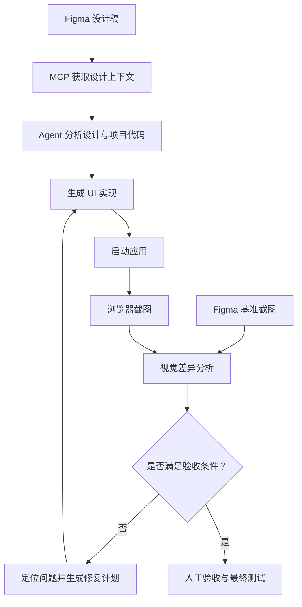
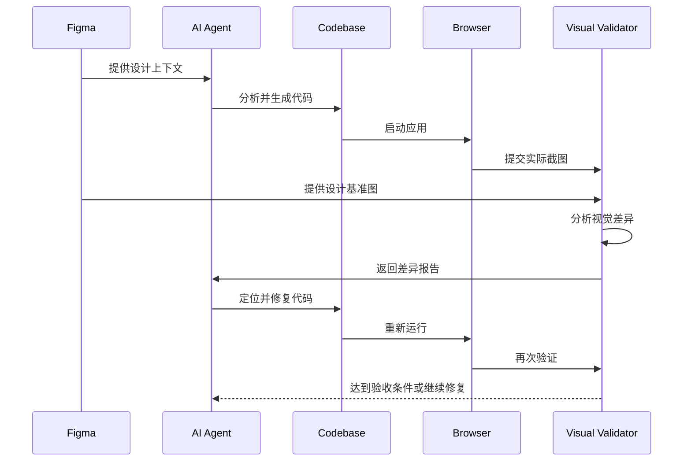

# Figma MCP 已经接入，为什么页面还是不够像？用 Agent Loop 建立视觉闭环

## 前言

使用 AI 编程工具实现 UI 时，很多开发者都经历过类似的过程：在 Figma 中选中设计稿，通过 MCP 将设计信息提供给 AI，AI 分析后生成代码；启动项目查看效果，却发现页面和设计稿仍然存在明显差异。

尤其是渐变、阴影、模糊滤镜、字体、间距以及复杂组件的细节，经常无法一次性还原。

这时我们容易怀疑模型能力不够强，或者提示词写得不够详细。但还有一个更关键的问题：**AI 生成代码之后，并没有获得足够有效的反馈，来判断页面实际渲染结果究竟哪里不符合预期。**

Figma MCP 解决的是设计上下文如何进入 AI 工作流；要提高 UI 还原度，还需要把代码实现、浏览器渲染、视觉比较和迭代修复连接起来。

本文尝试构建这样一套流程：以 Figma 为设计基准，以 MCP 提供上下文，以浏览器截图作为观测结果，再通过 Agent Loop 持续修复视觉偏差。

## 一、为什么 MCP 接入了，UI 还原度依然不理想？

首先需要明确：MCP 并不是一个自动将设计稿转换成完美代码的工具。Figma MCP Server 可以向 Agent 提供设计上下文，例如变量、组件和布局信息；真正生成项目代码的仍然是 AI Agent。两者承担的是不同职责。

接入 MCP 能减少设计信息传递过程中的损失，但不意味着最终浏览器渲染结果必然与 Figma 一致。

### 1. 设计信息本身不够明确

一个设计稿不只是颜色、尺寸和坐标的集合。一个按钮可能具有默认、悬停、按下和禁用状态，也可能存在多种尺寸、响应式布局规则、内边距、圆角和阴影。

如果这些信息没有通过组件、Variables、Auto Layout 或注释表达出来，Agent 就只能根据有限上下文推测实现方式。推测越多，结果越容易偏离设计意图。

### 2. 设计组件与代码组件没有建立映射

假设设计稿中存在一个 `PrimaryButton` 组件，而项目中已经有一个功能完整的按钮组件。如果 Agent 不知道两者之间的对应关系，它可能重新实现一个按钮，而不是复用已有组件。

这不仅容易造成视觉差异，还可能产生重复代码、样式不一致和维护成本。Figma Code Connect 可以将设计系统中的组件连接到真实代码组件，并提供导入方式、使用示例和属性映射等信息。

### 3. 设计稿与真实运行环境存在差异

设计稿和浏览器并不是同一个渲染环境。字体及字重、CSS 布局计算、浏览器默认样式、设备像素比、图片资源、SVG 渲染以及动画状态，都可能带来差异。

即使 CSS 属性看起来一致，最终视觉效果也可能不同。

### 4. AI 缺少真实渲染结果的反馈

传统的一次性代码生成流程通常是：

```text
设计稿 → AI 理解 → 生成代码 → 结束
```

AI 完成代码生成后，并不知道页面实际运行起来是什么样子。它可能认为布局、间距和渐变已经正确，但这些判断没有经过真实浏览器验证。

这就像让一个人根据施工图完成装修，却不允许他进入房间检查最终效果。**没有实际结果的反馈，就很难形成可靠的自我修正能力。**

## 二、MCP、Skill 和 Agent Loop 分别解决什么问题？

这三个概念经常出现在 AI Coding 工作流中，但它们不是同一种东西。

| 概念 | 核心职责 | 解决的问题 |
| --- | --- | --- |
| MCP | 提供工具和外部上下文 | AI 如何获取设计数据、调用外部能力 |
| Skill | 提供可复用的任务流程和规则 | AI 应该按照什么步骤完成任务 |
| Agent Loop | 形成观察、判断、执行、验证的循环 | AI 如何根据实际结果持续改进 |

例如：

- MCP 告诉 Agent：设计稿中的按钮宽度是 240px，圆角是 12px。
- Skill 告诉 Agent：优先查找项目已有按钮组件，使用设计变量，不要重复造轮子。
- Agent Loop 告诉 Agent：代码生成后必须打开页面截图，检查按钮是否符合设计稿；如果不符合，就继续修复。

三者配合起来，才构成相对完整的设计转代码工作流。

需要注意：Skill 本身不会自动增加 MCP 的工具能力，它主要负责组织和约束 Agent 如何使用已有能力。

## 三、建立完整的 UI 视觉反馈闭环

整个流程可以拆成六个阶段：

1. 读取设计上下文。
2. 分析项目组件和技术约束。
3. 生成或修改代码。
4. 启动应用并捕获实际渲染结果。
5. 分析视觉差异。
6. 根据差异修复代码，并重新验证。



最重要的变化是：代码生成不再是工作流的终点，而是一个可以反复执行的中间步骤。

### 1. 让设计稿具备机器可理解性

在要求 AI 生成代码之前，先检查 Figma 文件是否足够规范。

| 设计内容 | 推荐做法 | 目的 |
| --- | --- | --- |
| 图层 | 使用语义化名称 | 降低 Agent 理解成本 |
| 重复元素 | 抽取为 Component | 明确复用关系 |
| 颜色、间距、圆角 | 使用 Variables | 形成统一设计约束 |
| 响应式布局 | 使用 Auto Layout | 明确尺寸变化规则 |
| 复杂交互 | 添加注释 | 补充静态画面无法表达的信息 |
| 代码组件 | 配置 Code Connect | 连接设计组件与实际代码 |

尤其值得关注 Auto Layout。如果设计稿大量依赖绝对坐标，即使 Agent 能够读取每个元素的位置，也很难准确推断真正的响应式布局规则。

例如，`按钮位于 x=320、y=420，宽度为 240px` 描述的是当前画面的位置；而`按钮位于表单容器底部、宽度占满父容器、左右内边距为 24px` 描述的是布局关系。后者更有利于生成可维护的代码。

### 2. 建立设计组件与代码组件的映射

如果项目已经拥有设计系统，就不应该让 AI 每次都重新创造组件。例如：

| Figma Component | Code Component |
| --- | --- |
| PrimaryButton | Button |
| InputField | TextField |
| CardContainer | Card |
| ModalDialog | Dialog |

Agent 应优先复用已有组件，而不是生成一套独立的 HTML 和 CSS。这不仅提高视觉一致性，也减少生成代码时的自由度。

### 3. 捕获真实浏览器渲染结果

可以使用 Playwright 将当前页面转换成可供分析的截图。

安装依赖：

```bash
npm install -D playwright
npx playwright install chromium
```

一个简化的截图脚本：

```javascript
// scripts/capture-ui.mjs
import { chromium } from 'playwright';

const browser = await chromium.launch();

try {
  const page = await browser.newPage({
    viewport: { width: 1440, height: 900 },
    deviceScaleFactor: 1,
    locale: 'zh-CN',
    colorScheme: 'light',
    reducedMotion: 'reduce',
  });

  await page.goto('http://127.0.0.1:4321/login', {
    waitUntil: 'domcontentloaded',
  });

  await page.locator('[data-testid="login-view"]').waitFor({
    state: 'visible',
  });

  await page.evaluate(async () => {
    await document.fonts.ready;
  });

  await page.mouse.move(-1, -1);

  await page.screenshot({
    path: 'artifacts/current.png',
    animations: 'disabled',
    caret: 'hide',
  });
} finally {
  await browser.close();
}
```

几个容易忽略的细节：

- `viewport` 应与 Figma 设计稿的目标画布尺寸保持一致。
- `deviceScaleFactor` 应固定，避免截图像素尺寸变化。
- `document.fonts.ready` 可以避免字体尚未加载完成就截图。
- `animations: 'disabled'` 可以减少动画状态对截图的干扰。
- 最好等待明确的页面就绪标记，而不是简单地等待固定秒数。

对于存在动态内容的页面，还应该固定接口数据、时间、随机值和登录状态，否则两次截图可能产生差异。

## 四、如何量化设计稿与实际页面之间的差异？

截图只是观察结果，还需要比较机制。最直接的方法是使用图像像素比较。

安装依赖：

```bash
npm install -D pngjs pixelmatch
```

比较 Figma 导出的基准图片和浏览器截图：

```javascript
import { readFileSync, writeFileSync, mkdirSync } from 'node:fs';
import { PNG } from 'pngjs';
import pixelmatch from 'pixelmatch';

mkdirSync('artifacts', { recursive: true });

const expected = PNG.sync.read(readFileSync('design/login.png'));
const actual = PNG.sync.read(readFileSync('artifacts/current.png'));

if (
  expected.width !== actual.width ||
  expected.height !== actual.height
) {
  throw new Error('图片尺寸不一致，无法直接比较');
}

const diff = new PNG({
  width: expected.width,
  height: expected.height,
});

const diffPixels = pixelmatch(
  expected.data,
  actual.data,
  diff.data,
  expected.width,
  expected.height,
  {
    threshold: 0.12,
    includeAA: false,
  }
);

writeFileSync('artifacts/diff.png', PNG.sync.write(diff));

const totalPixels = expected.width * expected.height;
const diffRatio = diffPixels / totalPixels;

console.log({
  diffPixels,
  totalPixels,
  diffRatio: `${(diffRatio * 100).toFixed(2)}%`,
});
```

脚本会产生三个重要结果：

- `expected`：Figma 导出的设计基准图。
- `actual`：浏览器实际渲染结果。
- `diff`：两张图片之间的差异图。

注意，示例中的 `threshold` 是单个像素颜色差异的判断阈值，并不是允许整体图片有多少比例的差异。整体差异比例需要通过：

```text
差异比例 = 不同像素数量 / 图片总像素数量
```

计算。

### 像素差异并不等于视觉质量

不要把像素差异率当成唯一的 UI 还原度指标：

- 字体抗锯齿产生的细微差异，可能造成大量像素变化。
- 一个按钮整体偏移 10px，可能比很多分散的颜色差异更影响观感。
- 渐变颜色接近但方向错误，仍然属于明显的设计偏差。
- 阴影存在少量像素差异，却不一定影响整体视觉效果。

因此，视觉比较应该结合几种不同的检查方式：

| 检查方式 | 主要关注内容 |
| --- | --- |
| 像素差异 | 颜色、渐变、阴影、边缘 |
| 几何检查 | 元素位置、宽度、高度、间距 |
| 样式检查 | 字体、字重、行高、圆角、边框 |
| 语义检查 | 文本、组件类型、交互状态 |
| 行为检查 | 点击、悬停、响应式布局 |

例如，可以使用 Playwright 获取元素的实际位置：

```javascript
const box = await page
  .locator('[data-testid="primary-button"]')
  .boundingBox();

console.log(box);
```

如果已经从设计稿中明确知道按钮的目标坐标和尺寸，就可以对这些值进行独立断言，从而区分布局问题和像素渲染差异。

## 五、让 Agent 根据差异自动修复

现在已经有两个基础能力：Agent 能够读取设计上下文，系统能够获取实际渲染结果并分析差异。接下来就可以让 Agent 进入循环。

### 1. 不要一次性修复所有差异

假设视觉比较发现以下问题：

```text
[P0] 主容器整体向右偏移 16px
[P1] 主标题字体大小偏小
[P1] 表单项之间的间距偏大
[P2] 卡片阴影扩散范围不足
[P2] 按钮渐变方向不正确
```

可以先分类，再分批处理：

| 优先级 | 问题类型 | 修复策略 |
| --- | --- | --- |
| P0 | 整体布局、容器偏移、元素缺失 | 优先处理 |
| P1 | 字体、尺寸、间距、颜色 | 第二轮处理 |
| P2 | 阴影、渐变、滤镜、图标细节 | 最后处理 |

这是一种工程上的问题排序策略，并不是某个工具规定的固定标准。

### 2. 每次只让 Agent 处理明确的问题

可以给 Agent 提供这样的任务上下文：

```text
你正在执行 UI 视觉还原任务。

设计基准：design/login.png
当前页面截图：artifacts/current.png
视觉差异：artifacts/diff.png

当前发现的问题：
1. 主容器整体向右偏移 16px
2. 标题字体尺寸偏小
3. 卡片阴影扩散范围不足

修复约束：
1. 优先复用项目现有组件
2. 不要修改与当前问题无关的模块
3. 不要通过大量绝对定位强行覆盖布局问题
4. 优先检查父容器和设计变量
5. 完成修改后重新运行截图与视觉比较
6. 如果无法确认设计意图，明确报告，不要自行猜测
```

这样，Agent 不再只是生成代码，而是根据真实结果执行有约束的修复。

### 3. 完整的 Agent Loop



伪代码可以表示为：

```javascript
async function runVisualAgentLoop({
  design,
  maxIterations = 4,
}) {
  let report = null;

  for (let i = 0; i < maxIterations; i++) {
    await agent.implement({
      design,
      feedback: report,
    });

    const screenshot = await capturePage();

    report = await analyzeVisualDiff({
      design,
      screenshot,
    });

    if (report.passed) {
      return {
        success: true,
        iterations: i + 1,
        report,
      };
    }

    report = prioritizeIssues(report);
  }

  return {
    success: false,
    reason: '达到最大迭代次数',
    report,
  };
}
```

这里的 `agent`、`capturePage` 和 `analyzeVisualDiff` 是用于说明流程的抽象接口，不是某个现成库的 API。实际工程中需要根据 AI 编程工具、截图服务和图像分析模型实现。

## 六、Agent Loop 还需要解决哪些工程问题？

视觉闭环不是简单地无限循环。如果没有约束，Agent 可能不断修改代码，甚至越修越差。

### 1. 控制迭代次数

建议为每个页面设置最大迭代次数，例如 3～5 轮。如果连续两轮没有明显改善，就应该停止自动修复，并输出问题报告。

不要为了追求一个看似完美的差异率，让 Agent 无限消耗上下文和执行成本。

### 2. 保留每一轮的截图和修改记录

建议为每一轮保留：

```text
artifacts/
├── iteration-1/
│   ├── current.png
│   └── diff.png
├── iteration-2/
│   ├── current.png
│   └── diff.png
└── iteration-3/
    ├── current.png
    └── diff.png
```

这样可以观察每轮修复是否真正改善页面。如果某次修改导致差异明显增加，也能够快速回溯。

### 3. 不要让 Agent 自己随意更新基准图

这是视觉回归测试中非常重要的一点。

假设 Agent 修复后发现截图仍然有较大差异，于是直接把当前截图覆盖成新的基准图。下一次比较当然会通过，但这并不代表页面真的符合设计要求。

**基准图应该代表经过审核的设计目标，而不是每轮代码生成的最新结果。** 更新基准图必须经过明确的人工确认。

### 4. 不要只验证一个分辨率

一个页面在 1440px 宽度下看起来正常，并不代表在移动端也正常。可以为关键页面建立多个视口，例如：

| 设备类型 | 示例视口 |
| --- | --- |
| Desktop | 1440 × 900 |
| Tablet | 768 × 1024 |
| Mobile | 390 × 844 |

具体尺寸应根据项目目标设备确定。不同视口下的布局、字体和组件状态，都应该作为独立的验证目标。

### 5. 视觉通过不代表功能通过

页面看起来正确，并不意味着交互行为正确。例如按钮是否可以点击、表单是否能够提交、弹窗是否可以关闭、键盘焦点是否正确，以及响应式布局是否遮挡内容。

因此，视觉验证应该和功能测试、可访问性检查结合起来，而不是替代它们。

## 七、实践建议：从一个页面开始，而不是一次性自动化整个项目

如果准备在实际项目中落地这套流程，更建议分阶段实现。

**第一阶段：建立最小可用闭环**

- 选取一个有代表性的页面。
- 导出对应的 Figma 基准图。
- 固定浏览器视口和运行环境。
- 使用 Playwright 截图。
- 使用图像差异工具生成 diff。
- 由 AI 分析差异并进行一轮修复。

先确认整个链路能够跑通。

**第二阶段：提高设计上下文质量**

- 规范 Figma 图层名称。
- 将重复元素抽取成组件。
- 使用 Variables 统一颜色、间距和字体。
- 配置 Code Connect。
- 将项目组件使用规则整理成 Skill。

这一步主要解决 AI 的输入质量问题。

**第三阶段：提高自动诊断能力**

- 将页面划分为独立区域。
- 对关键组件增加几何约束。
- 使用多模态模型分析截图差异。
- 根据问题优先级生成修复任务。
- 保存每轮的截图、diff 和代码变更。

**第四阶段：建立人工验收机制**

自动化可以负责重复检查和常见问题修复，但设计意图、视觉取舍和最终发布仍然需要人工确认。对于复杂的渐变、滤镜、动画和品牌视觉细节，人工判断仍然具有不可替代的价值。

## 八、常见误区

### 误区一：接入 Figma MCP 就能保证像素级还原

MCP 提供的是设计上下文和工具能力，不是自动保证最终渲染效果的机制。

### 误区二：只要提示词足够详细，就不需要截图验证

提示词描述的是预期，截图反映的是真实结果。两者不能相互替代。

### 误区三：视觉差异率越低越好

不同操作系统、浏览器版本、字体和硬件环境都可能带来渲染差异。盲目追求零差异容易产生大量无意义的修复。

### 误区四：Agent 应该一次性修复所有问题

大规模修改会增加回归风险。更合理的方式是分类、排序、局部修复、重新验证。

### 误区五：通过视觉比较就能替代功能测试

截图无法证明交互逻辑、业务行为和无障碍能力正确。视觉验证只是质量保障的一部分。

## 结语

AI Coding 正在从单纯的代码生成，逐渐走向具备工具调用、环境观察和结果验证能力的 Agent 工作流。

在 UI 开发场景中，Figma MCP 解决了设计上下文的传递问题，Skill 让执行流程更加规范，而 Agent Loop 则让 AI 能够根据真实渲染结果持续修正自己的实现。

如果只关注第一次生成的代码，我们得到的仍然是一个开环系统。只有把设计输入、代码实现、浏览器观测、差异分析和迭代修复连接起来，才能逐渐形成一个真正可验证的闭环。

**AI 不应该只负责告诉我们它已经完成了，更应该能够拿出证据，证明它的实现确实符合预期。**

## 参考资料

1. [Figma MCP Server — Introduction](https://developers.figma.com/docs/figma-mcp-server/)
2. [Structure your Figma file for better code](https://developers.figma.com/docs/figma-mcp-server/structure-figma-file/)
3. [Code Connect integration](https://developers.figma.com/docs/figma-mcp-server/code-connect-integration/)
4. [Create skills for the Figma MCP server](https://developers.figma.com/docs/figma-mcp-server/create-skills/)
5. [Playwright — Visual comparisons](https://playwright.dev/docs/test-snapshots)
6. [Playwright — Locator API](https://playwright.dev/docs/api/class-locator)
7. [pixelmatch](https://github.com/mapbox/pixelmatch)

> 本文中的 Agent Loop 代码是用于说明工程流程的抽象示例；Playwright 和 pixelmatch 代码提供了可运行的验证基础。具体视觉验收阈值应由项目环境和设计要求确定。
