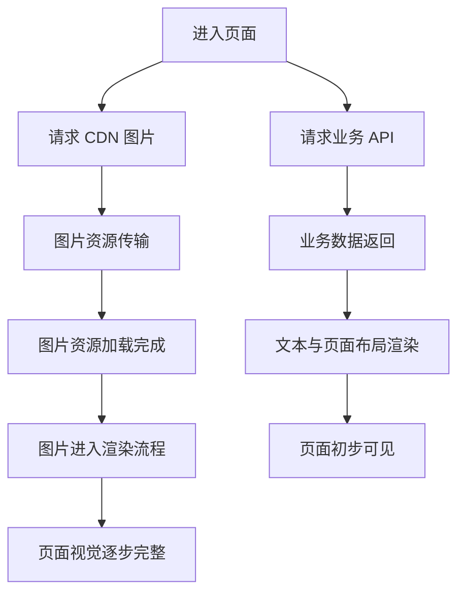

## 前言

开发微信小程序时，我们通常会把图片、字体等静态资源放到 CDN 上，以减轻业务服务器的压力，同时利用 CDN 的边缘节点加快资源分发。

但实际开发中，经常会遇到一种不太理想的情况：

页面中的文字已经显示出来了，布局也基本完成了，可背景图、装饰图、Banner 等资源还没有加载出来。

尤其是一些视觉设计比较丰富的页面，图片往往不是简单的内容补充，而是页面整体视觉的一部分。一旦图片迟迟没有出现，页面就会显得空荡、割裂，甚至让用户误以为页面还没有加载完成。

很多时候，我们的第一反应是：

- CDN 节点是不是不够快？
- 图片是不是太大了？
- 要不要换一家 CDN？
- 能不能提前加载图片？

这些方向都有价值，但如果只关注图片下载速度，可能会忽略真正影响体验的其他环节。

**图片加载优化的目标，不应该只是让图片尽可能快地下载完成，而是让页面在图片尚未就绪时依然保持完整、稳定，并且尽可能缩短关键视觉内容的等待时间。**

本文从小程序的资源加载流程出发，逐步拆解一套更系统的优化方案。

## 一、为什么文字已经显示，图片却还没出现？

首先需要明确一点：页面数据和图片资源通常不是同一个请求。

假设一个页面需要加载以下内容：

- 页面标题、描述和业务数据；
- 一张顶部 Banner；
- 几张装饰性图片；
- 一些列表缩略图。

页面可能通过业务 API 获取文字和结构化数据，而图片则通过 CDN 获取。

这意味着两类资源拥有不同的网络请求、不同的响应时间，也可能经过完全不同的网络链路。

可以用下面的流程理解：



因此，文字先显示出来并不一定意味着小程序出现了异常。

它可能只是说明：

1. 业务 API 响应比较快；
2. 图片 CDN 请求还没有完成；
3. 图片资源还需要经过后续的渲染处理；
4. 页面没有为图片未加载完成的状态设计合理的占位效果。

### 1. 图片加载并不只有网络传输

从用户体验的角度，可以把图片显示过程粗略拆成几个阶段：

| 阶段 | 主要工作 | 可能的影响因素 |
| --- | --- | --- |
| DNS 解析 | 查找资源域名对应的地址 | DNS 响应、预解析情况 |
| 网络连接 | 建立资源请求链路 | 网络质量、连接复用 |
| CDN 响应 | 从边缘节点或源站获取资源 | 缓存命中率、回源耗时 |
| 数据传输 | 下载图片文件 | 图片体积、带宽 |
| 图片处理 | 解码并准备渲染 | 图片尺寸、格式、设备性能 |
| 页面绘制 | 将图片显示到对应位置 | 页面布局和渲染状态 |

这里需要特别注意：

**CDN 只能优化资源分发链路中的一部分问题，并不能保证图片一定比业务 API 更早到达。**

例如，图片文件虽然部署在 CDN 上，但如果用户所在区域的边缘节点没有命中缓存，仍然可能发生回源；如果图片本身尺寸过大，网络传输和后续处理也可能耗费更多时间。

所以，单纯更换 CDN，并不一定能解决首屏图片迟迟不显示的问题。

## 二、先对图片进行分级，而不是所有图片一视同仁

图片优化最容易出现的误区，就是把所有图片都当作普通静态资源处理。

实际上，不同图片对用户体验的重要程度并不相同。

我更建议按照图片在页面中的视觉重要性，将其分成三类。

### 1. 第一类：首屏关键图片

例如：

- 首页顶部 Banner；
- 登录页背景图；
- 品牌 Logo 和核心 IP 形象；
- 页面中承担主要视觉表达的插画。

这类图片即使没有实际业务数据，也可能直接影响页面是否完整。

对于它们，应该优先保证可用性。

可以考虑以下策略：

- 图片较小且长期不变：优先考虑放在本地代码包中；
- 图片较大但首屏必须展示：提前预加载；
- 图片无法提前获取：准备与最终图片色调一致的占位背景。

本地资源的优势是可以避免页面展示时再经历一次远程网络请求，但也会增加代码包体积。因此，不应该把所有图片都放到本地，而是只选择少量高优先级资源。

### 2. 第二类：首屏非关键图片

例如：

- 装饰性背景纹理；
- 非核心插画；
- 不影响主要内容阅读的视觉点缀。

这类图片可以允许稍晚出现，但不应该让图片加载失败时的页面显得突兀。

可以通过背景色、渐变占位或者低清晰度缩略图，先建立页面的整体视觉结构。

### 3. 第三类：非首屏图片

例如：

- 长列表中的商品图片；
- 文章详情页下方的插图；
- 用户需要滚动后才能看到的图片。

这类资源不应该在页面打开时全部请求。

微信小程序的 `image` 组件提供了 `lazy-load` 属性，可以在图片即将进入可视区域时再加载资源。

```xml
<image
  src="{{item.imageUrl}}"
  mode="aspectFill"
  lazy-load
/>
```

这样可以减少首屏不必要的图片请求，让网络资源优先服务于当前真正需要展示的内容。

但需要注意：

**懒加载适合非首屏图片，不适合无差别地应用到所有图片。**

如果首屏 Banner 也启用了懒加载，反而可能延迟关键视觉资源的请求。

## 三、使用 wx.preloadAssets 提前准备关键图片

如果说懒加载是推迟不重要的图片，那么预加载就是提前准备重要的图片。

微信小程序提供了 `wx.preloadAssets` 接口，可以为视图层预加载媒体资源，目前支持图片和字体。

该接口从基础库 2.22.1 开始支持，使用前需要考虑项目的最低基础库版本。

### 1. 基本用法

```javascript
wx.preloadAssets({
  data: [
    {
      type: 'image',
      src: 'https://cdn.example.com/banner.webp'
    },
    {
      type: 'image',
      src: 'https://cdn.example.com/hero.webp'
    }
  ],
  success() {
    console.log('资源预加载成功');
  },
  fail(error) {
    console.warn('资源预加载失败', error);
  }
});
```

需要注意，这个 API 使用回调方式，不要直接假设它支持 Promise 风格调用。

### 2. 什么时候预加载最有价值？

预加载并不意味着页面打开时，把所有图片都提前请求一遍。

更合理的方式，是在用户可能进入下一个页面之前，提前准备少量高概率使用的资源。

例如：

用户正在浏览一个列表页面，首屏已经稳定展示，此时可以提前准备最可能进入的详情页封面。

```javascript
function preloadImages(urls = []) {
  if (typeof wx.preloadAssets !== 'function') {
    return;
  }

  const data = urls
    .filter(Boolean)
    .map(src => ({
      type: 'image',
      src
    }));

  if (!data.length) {
    return;
  }

  wx.preloadAssets({
    data,
    fail(error) {
      console.warn('图片预加载失败', error);
    }
  });
}

Page({
  onReady() {
    // 假设这些是下一页面最可能使用的关键图片
    const urls = (this.data.nextPageHeroUrls || []).slice(0, 1);

    preloadImages(urls);
  }
});
```

这里有几个值得注意的地方：

- 只预加载少量高优先级资源；
- 尽量利用用户停留在当前页面的时间；
- 不要为了等待预加载完成而阻塞页面跳转；
- 对不支持该接口的基础库保留正常加载路径；
- 不要将预加载成功等同于页面已经完成绘制。

预加载本身也会占用网络资源。如果同时预加载大量图片，反而可能与当前页面的业务请求竞争带宽。

因此，预加载应该建立在资源优先级之上，而不是越多越好。

## 四、占位渲染：图片慢一点，也不要让页面看起来没加载完

前面介绍的预加载和懒加载，主要解决资源请求的时机问题。

但实际工程中，我们很难保证每一张图片都能在预期时间内加载完成。

网络波动、CDN 回源、设备性能差异，都可能导致图片延迟。

因此，占位渲染同样重要。

它的核心思想是：

**在真实图片加载完成之前，先展示一个尺寸、颜色和布局都合理的占位层。**

### 1. 不要让图片决定页面布局

假设页面顶部有一张高度为 360rpx 的背景图。

如果图片加载完成之前，页面没有预留对应的空间，那么图片出现时可能会导致布局变化。

更好的方式是先确定容器尺寸，再将图片作为容器中的一层内容。

```xml
<!-- pages/home/index.wxml -->

<view class="hero">
  <view class="hero__placeholder"></view>

  <image
    class="hero__image {{heroLoaded ? 'hero__image--loaded' : ''}}"
    src="{{heroUrl}}"
    mode="aspectFill"
    bindload="onHeroLoad"
    binderror="onHeroError"
  />

  <view class="hero__content">
    <text class="hero__title">欢迎使用</text>
  </view>

  <view wx:if="{{heroFailed}}" class="hero__error">
    图片暂时无法加载
  </view>
</view>
```

对应的 WXSS：

```css
.hero {
  position: relative;
  height: 360rpx;
  overflow: hidden;
  background-color: #e9edf3;
}

.hero__placeholder {
  position: absolute;
  top: 0;
  right: 0;
  bottom: 0;
  left: 0;
  background: linear-gradient(
    135deg,
    #e8edf5,
    #f4f6fa
  );
}

.hero__image {
  position: absolute;
  top: 0;
  left: 0;
  width: 100%;
  height: 100%;
  opacity: 0;
  transition: opacity 200ms ease;
}

.hero__image--loaded {
  opacity: 1;
}

.hero__content {
  position: relative;
  z-index: 1;
}

.hero__error {
  position: absolute;
  right: 24rpx;
  bottom: 20rpx;
  z-index: 2;
}
```

页面逻辑：

```javascript
Page({
  data: {
    heroUrl: 'https://cdn.example.com/hero.webp',
    heroLoaded: false,
    heroFailed: false
  },

  onHeroLoad() {
    this.setData({
      heroLoaded: true,
      heroFailed: false
    });
  },

  onHeroError() {
    this.setData({
      heroLoaded: false,
      heroFailed: true
    });
  }
});
```

这个实现有几个好处：

1. 图片未加载完成时，容器已经占据正确的空间；
2. 占位层先显示，不会出现突兀的空白；
3. 图片加载成功后，通过透明度过渡自然出现；
4. 图片加载失败时，页面仍然有可用的视觉背景。

### 2. 占位图不一定非得是真实图片

对于装饰性图片，使用 CSS 渐变、背景色或者简单的几何形状，有时比再请求一张占位图片更合理。

如果占位图本身也需要从 CDN 下载，那么它就可能成为另一个等待对象。

如果图片是内容主体，例如用户头像、文章封面，则可以考虑生成低清晰度缩略图，先显示缩略版本，再替换成高清图片。

关键不是占位层有多复杂，而是它能否维持页面的视觉连续性。

### 3. CSS background-image 也需要考虑加载状态

如果使用 `background-image` 设置远程背景图，通常没有像 `image` 组件 `bindload`、`binderror` 那样直接的组件事件。

如果业务需要精确控制图片加载状态，可以考虑使用绝对定位的 `image` 组件作为背景层，将文字和其他内容放在上层。

这样既能保留背景图效果，也方便管理加载状态。

## 五、CDN 图片优化：不要只关注文件大小

前面解决的是加载时机和页面呈现问题。

如果图片本身过大，或者 CDN 缓存策略不合理，仍然会影响最终加载速度。

### 1. 图片尺寸应该与展示尺寸匹配

假设页面只需要展示一张宽度约为 375px 的 Banner，却从 CDN 下载了一张 3000px 宽的原图。

这意味着用户可能下载了远超实际展示需要的数据。

更合理的做法是根据图片展示尺寸和目标设备像素比，生成适当尺寸的资源。

例如：

- 小尺寸图标：提供适合实际显示大小的资源；
- 列表缩略图：提供较小的图片版本；
- 首屏 Banner：提供满足目标设备清晰度的版本；
- 详情页大图：按实际展示需求提供高清版本。

如果 CDN 支持图片处理，可以利用其缩放、裁剪和格式转换能力。

但要避免无限增加图片变体，否则会增加缓存条目和资源管理成本。

### 2. 合理选择图片格式

常见格式可以简单区分：

| 格式 | 主要特点 | 常见用途 |
| --- | --- | --- |
| PNG | 支持透明，适合无损图形 | Logo、透明插画 |
| JPEG | 有损压缩，适合复杂照片 | 照片、Banner |
| WebP | 支持有损、无损及透明 | 经过兼容性验证的图片资源 |
| SVG | 矢量图形，可缩放 | 图标、简单矢量插画 |

WebP 在不少场景下可以减少图片体积，但小程序的具体支持情况仍需要结合基础库版本、iOS/Android 客户端和渲染模式进行验证。

不要只根据开发者工具中的表现判断兼容性，至少应该在目标真机环境中测试。

### 3. CDN 缓存策略同样重要

对于内容长期不变的静态图片，可以使用带版本号或内容哈希的资源 URL。

例如：

```text
https://cdn.example.com/images/banner.v3.webp
```

当图片内容发生变化时，更新 URL，而不是在原 URL 背后直接替换内容。

对于这类真正不可变的公开静态资源，可以考虑类似的响应头：

```http
Cache-Control: public, max-age=31536000, immutable
```

它表示资源可以在较长时间内被缓存，并且在有效期内不需要重新验证。

但这个策略有一个前提：

**只有当 URL 对应的内容确实不会改变时，才适合使用长期不可变缓存。**

如果每次更新图片都复用同一个 URL，就可能出现 CDN 或客户端仍然使用旧图片的问题。

另外，用户私有图片、带权限控制的资源不能简单套用公开共享缓存策略，需要结合访问控制和缓存隔离进行设计。

## 六、如何判断优化是否真正有效？

图片加载优化很容易陷入一个误区：

在开发者工具里看起来变快了，就认为问题解决了。

但开发者工具、真机和真实用户网络环境可能存在差异。

更合理的方式是同时观察页面渲染、图片加载和资源请求情况。

### 1. 使用 wx.getPerformance 观察页面渲染

微信小程序提供了 `wx.getPerformance()`，可以获取一些性能数据。

例如，可以关注页面首次渲染相关指标：

```javascript
if (typeof wx.getPerformance === 'function') {
  const performance = wx.getPerformance();

  const observer = performance.createObserver((entryList) => {
    entryList.getEntries().forEach(entry => {
      if (entry.name === 'firstRender') {
        console.log('页面首次渲染耗时:', entry.duration);
      }
    });
  });

  observer.observe({
    entryTypes: ['render']
  });
}
```

需要注意：

`firstRender` 反映的是页面首次渲染相关情况，并不代表所有图片都已经加载完成。

因此，不能只看这个指标就判断图片体验是否达标。

### 2. 使用 bindload 和 binderror 记录图片状态

对于关键图片，可以通过组件事件记录从设置图片地址到加载回调的耗时。

例如：

```javascript
Page({
  setHeroImage(url) {
    this._heroSrcSetAt = Date.now();

    this.setData({
      heroUrl: url,
      heroLoaded: false,
      heroFailed: false
    });
  },

  onHeroLoad(event) {
    const duration = this._heroSrcSetAt
      ? Date.now() - this._heroSrcSetAt
      : undefined;

    console.log('关键图片加载回调耗时:', duration);

    // 可以在这里上报图片加载成功指标
  },

  onHeroError() {
    console.warn('关键图片加载失败');

    // 可以在这里上报图片加载失败指标
  }
});
```

这里记录的不是纯粹的网络下载耗时，而是从设置图片地址到收到组件加载完成回调的整个过程，包含组件更新和图片加载等环节。

这个指标更适合用于观察用户实际等待图片的时间。

### 3. 建议建立一组简单的观测指标

| 指标 | 用途 |
| --- | --- |
| 页面首次渲染耗时 | 判断页面是否及时显示 |
| 关键图片加载回调耗时 | 判断核心视觉资源等待时间 |
| 关键图片加载失败率 | 判断资源稳定性 |
| 首屏资源体积 | 判断是否存在资源过度加载 |
| CDN 缓存命中率 | 判断边缘缓存策略是否有效 |
| 冷启动与热启动差异 | 判断缓存是否显著改善体验 |

建议至少区分以下测试场景：

- 首次打开页面，尽可能接近冷缓存；
- 再次打开页面，观察缓存复用；
- 正常 Wi-Fi 环境；
- 移动网络或弱网环境；
- 不同系统、机型和基础库版本。

只有这些场景都经过验证，才能判断优化是否真正改善了用户体验。

## 七、常见误区总结

最后整理几个实际开发中容易出现的问题。

### 误区一：所有图片都放到 CDN 就够了

CDN 解决的是资源分发问题，不代表资源一定会及时到达。

还需要考虑资源体积、缓存命中、预加载、图片解码和页面占位。

### 误区二：所有图片都应该懒加载

懒加载适合非首屏资源。

对于首屏关键图片，应该优先考虑尽早请求，必要时进行预加载。

### 误区三：图片没加载出来，就显示一个 Loading

Loading 并不总是最好的占位方式。

对于装饰性背景和插画，渐变、背景色或者低清晰度占位图，往往比一个旋转图标更自然。

### 误区四：预加载越多越好

预加载会占用网络资源。

如果把所有图片都提前加载，可能会挤占业务 API 和关键图片的网络带宽，得不偿失。

### 误区五：只看页面首次渲染时间

页面已经完成首次渲染，不代表关键图片已经显示。

需要结合图片组件事件和真实设备表现，建立更贴近用户感知的指标。

## 八、实践建议：建立一套图片加载优先级

如果要将上面的方案落地，我更建议按以下顺序实施：

1. **先分级**：区分首屏关键图片、首屏非关键图片和非首屏图片。
2. **再减重**：按展示尺寸提供合适的图片资源，避免下载过大的原图。
3. **处理首屏**：小型关键静态资源优先考虑本地化，必要时使用 `wx.preloadAssets`。
4. **做好占位**：固定容器尺寸，先显示合理的背景或占位内容。
5. **延迟非关键资源**：对列表和非首屏图片使用懒加载。
6. **优化缓存**：为版本化静态资源配置合理的 CDN 缓存策略。
7. **最后验证**：通过性能数据、图片加载回调和真机弱网测试验证效果。

这套策略并不依赖某一家 CDN，也不依赖某一种图片格式。

它更像是一种资源调度思路：让真正影响首屏体验的资源优先到达，让不重要的资源适当延后，同时保证资源尚未到达时页面仍然保持良好的视觉状态。

## 结语

小程序图片加载优化，表面上看是一个资源加载问题，实际上涉及网络请求、缓存策略、资源调度、图片处理和页面渲染等多个环节。

我们不能要求所有图片都在页面打开的瞬间完成加载，但可以通过合理的资源优先级和占位策略，让用户不必一直等待图片，才能看到一个完整的页面。

**好的加载体验，不是让所有资源同时到达，而是让用户最先看到的内容始终是有意义的。**

## 参考资料

- [微信小程序 image 组件](https://developers.weixin.qq.com/miniprogram/dev/component/image.html)
- [微信小程序 wx.preloadAssets](https://developers.weixin.qq.com/miniprogram/dev/api/media/image/wx.preloadAssets.html)
- [微信小程序 wx.getPerformance](https://developers.weixin.qq.com/miniprogram/dev/api/base/performance/wx.getPerformance.html)
- [MDN：Cache-Control](https://developer.mozilla.org/en-US/docs/Web/HTTP/Reference/Headers/Cache-Control)
- [web.dev：Image performance](https://web.dev/learn/performance/image-performance)
- [web.dev：Serve responsive images](https://web.dev/articles/serve-responsive-images)
